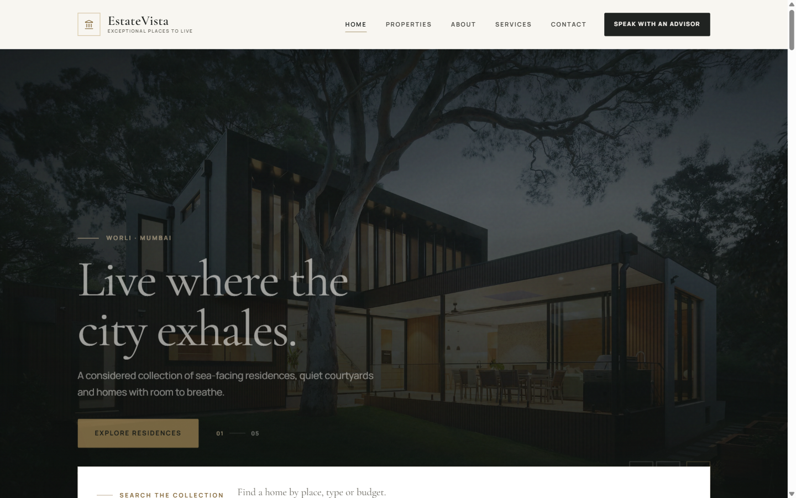

# EstateVista

A premium, data-driven real estate marketplace built with React and Vite. EstateVista presents a curated collection of homes, land and commercial spaces across India, with a complete public experience and a local property-management studio.

This project was prepared as a submission for the **Junior Frontend Developer real estate assignment from [Digitalsdaddy.com](https://digitalsdaddy.com)**. Digitalsdaddy.com is credited as the source of the assignment brief only; the EstateVista brand, design and implementation are independent work.



---

## Contents

- [Overview](#overview)
- [Feature highlights](#feature-highlights)
- [Tech stack](#tech-stack)
- [Getting started](#getting-started)
- [Available scripts](#available-scripts)
- [Routes](#routes)
- [Project architecture](#project-architecture)
- [Data model](#data-model)
- [Editing content](#editing-content)
- [Property persistence and reset](#property-persistence-and-reset)
- [Admin studio](#admin-studio)
- [Listing URL parameters](#listing-url-parameters)
- [Testing and quality checks](#testing-and-quality-checks)
- [Accessibility](#accessibility)
- [Responsive design](#responsive-design)
- [Deployment](#deployment)
- [Assignment requirement map](#assignment-requirement-map)
- [Limitations](#limitations)
- [Credits and attribution](#credits-and-attribution)

---

## Overview

EstateVista is a front-end marketplace concept. All repeatable content lives in `src/data/`, and reusable React components render that content without page-specific copies. Adding a property, changing a hero slide, updating a service or editing contact details flows through the relevant public pages automatically.

The property collection is presented as 16 coherent sample records: 13 available listings plus sold, rented and unavailable records that remain manageable in the admin studio but are excluded from public collection selectors.

The application includes:

- Six public pages plus a branded 404 page.
- A data-driven five-slide hero with autoplay, pause/play, arrows, pagination dots and reduced-motion support.
- Search, multi-field filters, sorting, pagination and a grid/list view on the properties page.
- Full property details with gallery, lightbox, specifications, amenities, facilities, agent card, enquiry form and related properties.
- A local admin studio with create, read, update, delete, validation, duplicate protection and reset-to-seed data flow.
- Immediate localStorage persistence and cross-tab synchronisation.
- Local fonts and 47 locally hosted images, so the site does not depend on third-party image or font CDNs at runtime.

## Feature highlights

### Public website

| Page | Highlights |
| --- | --- |
| **Home** | Five-slide hero, hero property search, featured/trending/latest collections, categories, popular locations, brand story, services, testimonials and call to action. |
| **Properties** | Available-only collection, keyword/location search, type/purpose/price/featured filters, newest/price sorting, pagination, active-filter chips, grid/list layouts and URL-synchronised state. |
| **Property details** | Image gallery and lightbox, price, address, type/purpose/status, full specification set, description, amenities, facilities, advisor contact card, enquiry form and related properties. |
| **About** | Company story, mission and vision, statistics, values, team profiles and why-choose section. |
| **Services** | Five data-driven service offerings with descriptions, imagery and process guidance. |
| **Contact** | Validated contact form, phone/email/address, business hours, social links and a clearly labelled map placeholder. |
| **404** | Branded not-found experience with links back to the collection and the homepage. |

### Admin studio

- Dashboard totals for all, available, sold, rented and unavailable records.
- Search by reference, title, slug, city, area or type.
- Status filtering and a responsive table/card presentation.
- Create and edit forms with shared validation and duplicate ID/slug protection.
- Accessible delete confirmation and full reset confirmation.
- Success and error toasts.
- Changes persist immediately and appear on public pages without a rebuild.

## Tech stack

| Tool | Version | Purpose |
| --- | --- | --- |
| React | 19.3.1 | Component model and UI |
| React DOM | 19.3.1 | Browser rendering |
| React Router DOM | 7.18.5 | Public and admin routing |
| Vite | 8.3.5 | Development server and production build |
| JavaScript / JSX | ES2022+ | Application code |
| Lucide React | 1.63.0 | Interface icons |
| Vitest | 5.0.5 | Test runner |
| Testing Library / jest-dom | 16.3.3 / 6.9.1 | Component and DOM assertions |
| ESLint | 10.13.0 | Static analysis |
| Plain CSS | — | Design tokens and responsive styles |

The project was developed and verified with Node.js **24.18.0** and npm **11.16.0**. Vite 8 requires a modern Node.js release; use Node.js 20.19+ or 22.12+ at minimum.

## Getting started

### Prerequisites

- Node.js 20.19+ (Node.js 22 LTS or newer recommended)
- npm 10+

### Install and run

```bash
npm install
npm run dev
```

Open the URL printed by Vite, typically <http://localhost:5173/>.

### Production preview

```bash
npm run build
npm run preview
```

The production preview runs at <http://localhost:4173/> by default.

### First run

No environment variables, API keys or external services are required. On first visit, the property repository seeds the canonical collection from `src/data/properties.js` into browser localStorage.

## Available scripts

| Command | Description |
| --- | --- |
| `npm run dev` | Start the Vite development server with hot reload. |
| `npm run build` | Create a production build in `dist/`. |
| `npm run preview` | Serve the production build locally. |
| `npm test` | Run all Vitest suites once. |
| `npm run test:watch` | Run Vitest in watch mode. |
| `npm run lint` | Run ESLint across the project. |
| `npm run lint:fix` | Apply safe ESLint fixes. |

## Routes

### Public routes

| Route | Page |
| --- | --- |
| `/` | Homepage |
| `/properties` | Property listing |
| `/properties/:slug` | Property details |
| `/about` | About EstateVista |
| `/services` | Services |
| `/contact` | Contact |
| `*` | Branded 404 |

### Admin routes

| Route | Page |
| --- | --- |
| `/admin` | Redirects to `/admin/properties` |
| `/admin/properties` | Property dashboard |
| `/admin/properties/new` | Create property |
| `/admin/properties/:id/edit` | Edit property |

Unknown property slugs and unknown non-admin routes render the branded 404 page. The admin studio is an unauthenticated local browser-only tool.

## Project architecture

```text
estatevista/
├── public/
│   ├── _redirects                 # Netlify SPA fallback
│   ├── favicon.svg
│   ├── fonts/                     # Local Cormorant Garamond and Manrope WOFF2 files
│   └── images/                    # 47 locally hosted property images
├── screens/                       # Browser QA screenshots
├── src/
│   ├── app/
│   │   ├── App.jsx                # Toast + property providers
│   │   └── router.jsx             # Public/admin route definitions
│   ├── components/
│   │   ├── admin/                 # Dashboard form, table, delete confirmation, layout
│   │   ├── common/                # Buttons, fields, modal, images, headers, cards
│   │   ├── contact/               # Contact and property enquiry forms
│   │   ├── home/                  # Hero, search and all homepage sections
│   │   ├── layout/                # Header, footer, mobile navigation, public layout
│   │   └── properties/            # Cards, grid, filters, sort, view toggle, gallery, pagination
│   ├── context/                   # Property and toast context providers
│   ├── data/                      # All editable content
│   ├── hooks/                     # useProperties, useReducedMotion, useToast
│   ├── pages/                     # Six public pages, 404 and admin pages
│   ├── services/                  # Repository, selectors, validation, formatters, URL state
│   ├── styles/
│   │   ├── tokens.css             # Fonts, colours, type, spacing, motion tokens
│   │   ├── global.css             # Reset, base elements, accessibility utilities
│   │   ├── components.css         # Shared UI components
│   │   ├── pages.css              # Page and feature styles
│   │   ├── admin.css              # Admin studio styles
│   │   └── responsive.css         # Refinements down to 320px and reduced motion
│   ├── test/                      # Vitest suites, fixtures and setup
│   └── main.jsx                   # React root and style imports
├── index.html
├── vite.config.js
├── eslint.config.js
├── vercel.json
└── package.json
```

### Architectural boundaries

- **`src/data/`** contains content and option lists only. UI components do not hard-code listing, service, team or testimonial content.
- **`src/services/`** contains framework-independent logic: storage, validation, selectors, formatting and URL parsing.
- **`src/context/` and `src/hooks/`** connect services to React state and expose a small, reusable API.
- **`src/components/`** contains reusable presentation and interaction components.
- **`src/pages/`** composes components and services into routes.

## Data model

Every property uses the same canonical shape. Optional presentation flags are included for all records so the schema remains predictable.

```js
{
  id: 'PROP-001',
  slug: 'the-arbour-residence-worli',
  title: 'The Arbour Residence',
  type: 'apartment',              // apartment | house | villa | plot | commercial
  purpose: 'sale',                // sale | rent
  price: 68500000,
  currency: 'INR',
  location: {
    city: 'Mumbai',
    area: 'Worli',
    address: '14 Marine Crescent, Worli, Mumbai 400018',
  },
  specifications: {
    bedrooms: 4,
    bathrooms: 4,
    area: 2850,
    areaUnit: 'sqft',             // sqft | sqm | sqyd | acres
  },
  images: [
    '/images/property-1.jpg',
    '/images/property-2.jpg',
    '/images/property-3.jpg',
  ],
  description: 'A sea-facing residence…',
  amenities: ['Sea view', 'Private lift lobby'],
  facilities: ['Power backup', 'Gymnasium'],
  status: 'available',            // available | sold | rented | unavailable
  featured: true,
  trending: true,
  createdAt: '2026-10-22',
}
```

### Validation rules

The shared validator in `src/services/validation.js` enforces:

- IDs matching `^[A-Z0-9-]+$` and unique across the collection.
- Lowercase kebab-case slugs, unique across the collection, up to 100 characters.
- Titles of 3–120 characters.
- Supported property types, purposes, statuses and area units.
- Non-negative numeric prices and positive numeric areas.
- Non-negative whole-number bedroom and bathroom counts.
- A three-letter currency code.
- City, area and a full address.
- Image paths that are local paths, `http(s)` URLs or image data URLs.
- Descriptions of 20–2,500 characters.
- Boolean `featured` and `trending` flags.
- A valid creation date.

Admin form validation additionally requires a positive price greater than zero.

### Selection rules

- **All properties:** records with `status === 'available'`.
- **Featured:** available records with `featured === true`.
- **Trending:** available records with `trending === true`.
- **Latest:** available records sorted by `createdAt`, newest first.
- **Type collections:** available records filtered by `type`.
- **Rentals:** available records filtered by `purpose === 'rent'`.

The same property object is reused across every section; there are no duplicate per-section property copies.

## Editing content

Repeatable and collection-level content is centralised in `src/data/`:

| File | Content |
| --- | --- |
| `site.js` | Brand name, tagline, default currency and global settings. |
| `navigation.js` | Header and footer navigation. |
| `hero-slides.js` | Five hero slides, media, copy, CTA, active state and duration. |
| `properties.js` | The 16 canonical sample property records. |
| `categories.js` | Property category cards. |
| `locations.js` | Popular location cards. |
| `services.js` | Five service offerings. |
| `testimonials.js` | Customer testimonials. |
| `team.js` | Team profiles. |
| `about.js` | Story, mission, vision, statistics and values. |
| `contact.js` | Contact details, office information, hours and social links. |
| `propertyOptions.js` | Type, purpose, status, area-unit and sort option lists. |

### Add or edit a property in the seed data

1. Open `src/data/properties.js`.
2. Add a new object using the canonical shape above. Use a unique `id`, unique `slug`, valid `type`, `purpose`, `status` and `createdAt`.
3. Reference local images from `public/images/` using a path such as `/images/property-12.jpg`, or use absolute `http(s)` URLs.
4. Reload the app. If the browser already has saved data, the repository preserves it. Reset the storage key or use **Reset property data** to reload the edited seed collection.

> The seed file is the initial data source, not a live synchronisation target. Once localStorage contains a valid collection, edits to `properties.js` do not overwrite the user's saved records. This is intentional CRUD behaviour.

### Add a hero slide

Add an object to `src/data/hero-slides.js`:

```js
{
  id: 'SLIDE-06',
  mediaType: 'image',             // image | video
  mediaSrc: '/images/hero-5.jpg',
  poster: '/images/hero-5.jpg',   // used as video poster or image fallback
  alt: 'Descriptive alternative text',
  eyebrow: 'Location · City',
  heading: 'A considered headline.',
  subtitle: 'Supporting copy for the slide.',
  ctaLabel: 'Explore',
  ctaTo: '/properties',
  isActive: true,
  duration: 7000,
}
```

Set `isActive: false` to keep a slide in the file without rendering it. Missing media is handled by the shared `SmartImage` fallback and the hero's image fallback.

### Add a service

Add an object to `src/data/services.js`. The homepage renders the first three services, while `/services` renders all five from the same collection.

## Property persistence and reset

### Storage key

```text
estatevista.properties.v1
```

The repository in `src/services/propertyRepository.js`:

- Seeds the collection when the key is missing.
- Validates the complete saved collection on read.
- Replaces malformed JSON, invalid records, duplicate IDs or duplicate slugs with the known-good seed collection.
- Preserves a valid empty array, allowing the admin studio to show its empty state.
- Falls back to an in-memory store when localStorage is blocked; the app remains usable for the current session.
- Writes immediately after every create, update and delete.
- Dispatches React updates and listens for the browser `storage` event, so other open tabs refresh when the collection changes.
- Throws typed errors for validation, missing records and storage failures; these are surfaced as form errors or toasts.

### Reset options

**In the interface**

1. Open `/admin/properties`.
2. Choose **Reset property data**.
3. Confirm **Reset all property data**.

**In browser developer tools**

```js
localStorage.removeItem('estatevista.properties.v1');
location.reload();
```

The next load re-seeds the collection from `src/data/properties.js`.

**Clear all site data** through the browser's site-settings panel for the same effect.

## Admin studio

Open <http://localhost:5173/admin/properties>.

### Create

1. Select **Add property**.
2. Complete the required fields. The slug auto-generates from the title until you edit it manually.
3. Choose a status. Only `available` records appear in public collection selectors.
4. Submit. The next reference is shown before saving and is generated as `PROP-###`.

### Read and search

The dashboard lists every record, including sold, rented and unavailable properties. Use the search field, status cards or status dropdown to narrow the table. On narrow screens the table becomes a set of accessible record cards.

### Update

Choose **Edit** on any record. The same form component validates changes, preserves the original ID and creation date, and checks slug uniqueness against the rest of the collection.

### Delete

Choose **Delete**, review the property in the confirmation modal, then confirm. The record is removed from storage immediately and the public pages update.

### Reset

Use **Reset property data** to replace the entire browser collection with the original seed records.

## Listing URL parameters

The properties page synchronises supported filters, sorting and pagination with the URL, making filtered collections shareable and browser-navigation friendly.

| Parameter | Values | Example |
| --- | --- | --- |
| `q` | Free-text keyword | `/properties?q=sea+view` |
| `location` | City, area or address text | `/properties?location=Goa` |
| `type` | `apartment`, `house`, `villa`, `plot`, `commercial` | `/properties?type=villa` |
| `purpose` | `sale`, `rent` | `/properties?purpose=rent` |
| `minPrice` | Non-negative number | `/properties?minPrice=5000000` |
| `maxPrice` | Non-negative number | `/properties?maxPrice=9000000` |
| `featured` | `true` | `/properties?featured=true` |
| `sort` | `newest`, `price-asc`, `price-desc` | `/properties?sort=price-asc` |
| `page` | Positive integer (6 records per page) | `/properties?page=2` |

Unsupported or malformed values are ignored and replaced with safe defaults. Removing filters updates the URL with `replace`, so every chip change does not create a separate history entry. The grid/list presentation is a UI preference and is not encoded in the URL.

## Testing and quality checks

The test suite covers:

- Repository seeding, CRUD, malformed storage recovery, duplicate validation and storage failures.
- Filtering, search, sorting, pagination, related properties and statistics.
- Schema validation, slug generation and form conversion/validation.
- Public properties page rendering, URL-synced filters, search, sorting and grid/list switching.
- Admin form validation, duplicate slugs and successful submission.
- Hero accessibility, autoplay, pause/play and reduced-motion behaviour.
- Search-parameter parsing, construction and active-filter counts.

Run the full verification set:

```bash
npm test
npm run lint
npm run build
```

The implementation is verified in a real Chromium browser at 320px, 390px and desktop widths, including all public and admin routes, mobile navigation, gallery, filters, pagination and a complete create → reload → update → delete CRUD cycle.

## Accessibility

- Semantic page landmarks, headings and lists.
- A skip link to the main content.
- Visible focus styles and keyboard-operable controls.
- Hero carousel with labelled region, `aria-roledescription`, slide announcements, labelled previous/next buttons, pagination dots and pause/play.
- Modal and mobile navigation focus trapping, Escape dismissal, background scroll lock and focus restoration.
- Form labels, descriptions, `aria-invalid`, inline error messages and focus movement to the first invalid field.
- Live regions for listing counts and toast notifications.
- Alternative text for meaningful imagery; decorative icons hidden from assistive technology.
- Colour combinations designed for readable contrast, with improved overlays on image headers.
- `prefers-reduced-motion` support that disables autoplay and reduces non-essential transitions.
- Responsive layouts tested from 320px upward without horizontal page overflow.

## Responsive design

The CSS layers provide desktop, tablet and mobile refinements at 1280, 1100, 1024, 900, 768, 640, 480 and 380 pixels, plus hover and reduced-motion media queries. Key mobile adaptations include:

- A compact header with an accessible slide-out navigation.
- A single-column hero with stacked search controls.
- Collapsible property filters.
- Single-column property grids and stacked list-view cards.
- Scrollable admin tables or record cards.
- Reduced type sizes and spacing at 320px.

## Deployment

The project is a single-page application and needs a host that rewrites unknown paths to `index.html`.

### Netlify

`public/_redirects` is included:

```text
/*    /index.html   200
```

Build settings:

- Build command: `npm run build`
- Publish directory: `dist`

### Vercel

`vercel.json` is included with a catch-all rewrite to `/index.html`. Import the repository, keep the Vite preset, and deploy.

### Other static hosts

Run `npm run build` and upload `dist/`. Configure an SPA fallback so routes such as `/properties/the-arbour-residence-worli` and `/admin/properties` resolve to `index.html`.

### Important deployment note

The admin studio is a front-end property manager for local browser use. Its data is stored in each visitor's browser. It is not multi-user, authenticated or backed by a database. Do not treat it as a production property-management system.

## Assignment requirement map

| Requirement | Implementation |
| --- | --- |
| Data-driven architecture | `src/data/` modules consumed by reusable components and selectors. |
| Six public pages | Home, Properties, Property Details, About, Services, Contact. |
| Homepage hero slider with five slides | `src/data/hero-slides.js` + `HeroSlider.jsx`, with media type, copy, CTA, active state and duration. |
| Slider controls and autoplay | Arrows, pagination dots, pause/play, 7-second autoplay and reduced-motion handling. |
| Search by name/location and filters | Keyword/location search plus type, purpose, price and featured filters. |
| Sorting | Newest, price low-to-high and price high-to-low. |
| Grid/list layouts | Accessible toolbar toggle with responsive grid and editorial list cards. |
| Pagination | Six records per page with URL-synced page state. |
| Property details by ID or slug | `/properties/:slug`, with a clear 404 for unknown records. |
| Gallery, specs, amenities, facilities | Full details page with lightbox and specification components. |
| Contact/agent section | Advisor card, phone/email links and validated enquiry form. |
| Related properties | Scored by type, city, area, purpose and price proximity. |
| About page content | Story, mission, vision, statistics, values, team and why-choose content. |
| Data-driven services | Five services rendered on `/services`; first three on the homepage. |
| Contact page | Details, hours, social links, validated form and labelled map placeholder. |
| CRUD | Create, read, update and delete through the admin studio. |
| Persistence | Immediate localStorage writes and cross-tab updates. |
| Initial data from a data file | First load seeds from `src/data/properties.js`. |
| Responsive design | Tested from 320px through desktop. |
| README documentation | This document. |

## Limitations

- **Property records are local catalogue content.** Property records, prices, availability, addresses, team members, testimonials and contact details are curated catalogue content for the project and should be replaced with verified listings for production use.
- **No backend.** The application has no server, database, authentication or role-based access control. The admin studio is open to anyone who visits `/admin`.
- **Per-browser storage.** Records do not synchronise across browsers or devices. Clearing site data removes local changes.
- **Form submissions are simulated.** Contact and property enquiry forms validate input and show success feedback, but they do not send email or persist messages.
- **Map is a placeholder.** No map provider or embed URL is configured, so the contact page labels the placeholder rather than presenting it as a live map.
- **Image and font assets are local project assets.** Photography is sourced from Unsplash for the project build; replace it with licensed production assets before commercial use.
- **No payments, saved searches, user accounts or CRM integration.** These are outside the assignment scope.
- **Seed edits require a reset for existing browsers.** Once a valid collection is stored, the data file is not re-applied automatically.
- **Browser storage can be unavailable.** The repository falls back to memory, but changes then last only for the current session.

## Credits and attribution

- **Assignment brief:** [Digitalsdaddy.com](https://digitalsdaddy.com) — Junior Frontend Developer real estate website assignment. This attribution appears in project documentation only and is not used as website branding.
- **Photography:** [Unsplash](https://unsplash.com) contributors, downloaded locally for the project build. Replace with appropriately licensed production imagery before commercial use.
- **Fonts:** Cormorant Garamond and Manrope, served as local WOFF2 files.
- **Icons:** [Lucide](https://lucide.dev).
- **Framework and tooling:** React, React Router, Vite, Vitest, Testing Library and ESLint.

EstateVista is an independent real-estate marketplace concept. It is not affiliated with, endorsed by or sponsored by any property brand, agency or listing service.
