# 01 — EstateFlow company panel: overview

Target: `https://estateflow.devintime.com`
Area: authenticated company panel (`/company/*`)
Observed: 2026-11-16
Demo account: `company@example.com` (password supplied with the demo, intentionally **not** recorded here)
Method: black-box browser observation only. No source access, no vulnerability probing, no fuzzing, no other tenants' data.

---

## 1. What the product is

EstateFlow is a multi-tenant real-estate ERP for a developer/agency. One company workspace combines:

- property inventory (projects → buildings → floors → units),
- the full sales pipeline (leads → visits → customers → quotations → reservations → sales → installments → collections),
- rental management (tenants → leases → rent roll → rent collections → deposits → maintenance),
- construction/procurement (materials, stock, issues, labour, contractors, purchase orders, purchases),
- finance and accounting (expenses, income, payouts, bank/cash, loans, chart of accounts, journals, reports),
- HR (employees, attendance, leave, payroll, advances),
- a public website CMS,
- workspace/operations (tasks, approvals, notifications, contracts),
- company setup (team, roles, branches, settings, master data).

The panel is server-rendered; it feels like a classic Bootstrap admin application rather than a SPA.

---

## 2. Evidence standard

| Label | Meaning in these docs |
|---|---|
| **Observed** | Seen directly in the demo UI, HTML, or network traffic. |
| **Inferred** | Strongly implied by observed links, field names, or behaviour, but not exercised. |
| **ASSUMPTION** | Behaviour we could not verify; needed for planning and explicitly flagged. |
| **Not observed** | A flow that exists in navigation but was not exercised end-to-end. |

Limits of this pass:

- Deletion is globally disabled in the demo: any `DELETE` returns **403** `{"message":"This action is disabled in the demo version."}`. CRUD was exercised fully only for create/update/validation on **leads**; other modules were documented from their list/detail/form markup.
- Email/SMS/WhatsApp delivery, payment-gateway callbacks, and PDF/print output were not triggered.
- File uploads were inspected but not uploaded.
- Report figures were read from the demo dataset; they are sample data, not business rules.
- One temporary lead remains in the demo (see §9).

---

## 3. Observed technical architecture

| Layer | Observation |
|---|---|
| Rendering | HTML is fully server-rendered. Every page is a document request; no client router. |
| Server | PHP/Laravel conventions: `_token` CSRF field, `_method` spoofing, session cookies, `XSRF-TOKEN` cookie, 302 POST/Redirect/GET, validation errors in the Laravel `{message, errors}` shape. |
| CSS | Bootstrap 5 + Bootstrap Icons + a custom theme stylesheet. |
| JS | jQuery, Bootstrap bundle, Select2, Flatpickr, SweetAlert2, Notyf, plus `app.js` and `crud.js`. |
| Charts | CSS bar chart driven by `data-width` / `data-height` attributes; no chart library was loaded on the dashboard. |
| Tables | Server-rendered tables with GET filter forms; pagination links. Projects use cards instead of a table. |
| Identifiers | UUIDs in detail/edit URLs (e.g. `/company/leads/01a1e50a-…`); human reference numbers in the UI (`SAL-2026-00069`, `PRJ-0002`, `LSE-2026-00017`, `PO-2026-00016`, `JE-2026-000933`). |
| Currency | Configurable per company/project; demo data mixes `$` display with BDT (`৳`) account names and notifications. |
| Languages | English, Arabic, French; UI direction (LTR/RTL) is a language property. |
| Analytics | Google Analytics `G-WMCC19VB11` is embedded. It is third-party and irrelevant to the product domain. |

### Request conventions (observed)

- HTML forms are `method="POST"`; edit/delete use a hidden `_method` (`PUT`/`PATCH`/`DELETE`).
- AJAX submissions send `X-CSRF-TOKEN` and `Accept: application/json`.
- Success: HTTP 200 `{ "message": "...", "redirect": "..." }` (or a page reload).
- Validation: HTTP 422 `{ "message": "...", "errors": { "field": ["..."] } }`.
- Demo-blocked delete: HTTP 403 `{ "message": "This action is disabled in the demo version." }`.
- Login POST redirects **302 → /company/dashboard**; rate-limit headers were present (`x-ratelimit-limit: 10`).
- Details are in `04-api-contract.md`.

---

## 4. Application shell

```
┌──────────────────────────────────────────────────────────────────────┐
│ topbar: brand · apps/search · theme · fullscreen · language ·        │
│         notifications · avatar                                       │
├───────────────┬──────────────────────────────────────────────────────┤
│ sidebar       │ breadcrumb bar                                       │
│ (14 groups)   │ page header / tabs / actions                         │
│               │ KPI cards, filters, tables/cards, charts             │
│               │ footer: "Acme Realty © 2026. All rights reserved."    │
└───────────────┴──────────────────────────────────────────────────────┘
```

Observed shell behaviour:

- Sidebar groups expand/collapse; the active route is highlighted.
- Topbar avatar menu: **My Profile**, **Change password** (profile `#security`), **Logout** (POST form with CSRF).
- Notification bell opens a feed; the feed marks individual items read and supports mark-all.
- Language menu: `/language/ar`, `/language/en`, `/language/fr` (GET), persists the choice in session.
- Theme toggle stores `theme` in `localStorage`; fullscreen uses the browser Fullscreen API.
- Breadcrumbs reflect the module hierarchy (`Dashboard Sales Leads …`).
- Flash messages appear as Notyf toasts; destructive actions use SweetAlert2 confirmations.

---

## 5. Module map

```mermaid
flowchart TD
  A[Company panel] --> P[Properties]
  A --> S[Sales]
  A --> R[Rental]
  A --> PM[Payments]
  A --> C[Construction]
  A --> W[Workspace]
  A --> PU[Purchasing]
  A --> F[Finance]
  A --> AC[Accounting]
  A --> HR[HR]
  A --> WEB[Website CMS]
  A --> OT[Operation Team]
  A --> SET[Setup]

  P --> P1[Projects]
  P --> P2[Units]

  S --> S1[Leads]
  S --> S2[Site visits]
  S --> S3[Customers]
  S --> S4[Quotations]
  S --> S5[Reservations]
  S --> S6[Sales]
  S --> S7[Installments]
  S --> S8[Collections]
  S --> S9[Commissions]

  R --> R1[Occupancy]
  R --> R2[Tenants]
  R --> R3[Leases]
  R --> R4[Rent roll]
  R --> R5[Rent collections]
  R --> R6[Security deposits]
  R --> R7[Maintenance]

  PM --> PM1[Payment links]
  PM --> PM2[Online payments]
  PM --> PM3[Refunds]

  C --> C1[Materials]
  C --> C2[Stock]
  C --> C3[Material issues]
  C --> C4[Laborers]
  C --> C5[Labor attendance]
  C --> C6[Contracts]

  W --> W1[Tasks]
  W --> W2[Recurring tasks]
  W --> W3[Approvals]
  W --> W4[Notifications]

  PU --> PU1[Purchase orders]
  PU --> PU2[Purchases]
  PU --> PU3[Suppliers]
  PU --> PU4[Contractors]

  F --> F1[Expenses]
  F --> F2[Other income]
  F --> F3[Payouts]
  F --> F4[Bank & cash]
  F --> F5[Loans]

  AC --> AC1[Chart of accounts]
  AC --> AC2[Journal entries]
  AC --> AC3[Reports]

  HR --> H1[Employees]
  HR --> H2[Attendance]
  HR --> H3[Leave]
  HR --> H4[Payroll]
  HR --> H5[Salary advances]
  HR --> H6[HR setup]

  WEB --> WB1[Inquiries]
  WEB --> WB2[Page content]
  WEB --> WB3[Insights articles]
  WEB --> WB4[Gallery]
  WEB --> WB5[Testimonials / FAQ / Leadership / Milestones]
  WEB --> WB6[Listing photos]
  WEB --> WB7[Legal pages]
  WEB --> WB8[Website settings]

  OT --> O1[Team]
  OT --> O2[Roles & permissions]
  OT --> O3[Branches]

  SET --> E1[Settings]
  SET --> E2[Languages]
  SET --> E3[Master data]
  SET --> E4[Material categories]
  SET --> E5[Warehouses]
  SET --> E6[Expense categories]
  SET --> E7[HR setup]
  SET --> E8[Notification settings]
  SET --> E9[Delivery log]
  SET --> E10[Audit log]
```



---

## 6. Complete sidebar route inventory (observed)

| Group | Label | Route |
|---|---|---|
| — | Dashboard | `/company/dashboard` |
| Properties | Projects | `/company/projects` |
| Properties | Units | `/company/units` |
| Sales | Leads | `/company/leads` |
| Sales | Site visits | `/company/visits` |
| Sales | Customers | `/company/customers` |
| Sales | Quotations | `/company/quotations` |
| Sales | Reservations | `/company/reservations` |
| Sales | Sales | `/company/sales` |
| Sales | Installments | `/company/installments` |
| Sales | Collections | `/company/collections` |
| Sales | Commissions | `/company/commissions` |
| Rental | Occupancy | `/company/occupancy` |
| Rental | Tenants | `/company/tenants` |
| Rental | Leases | `/company/leases` |
| Rental | Rent roll | `/company/rent-roll` |
| Rental | Rent collections | `/company/rent-collections` |
| Rental | Security deposits | `/company/deposits` |
| Rental | Maintenance | `/company/maintenance` |
| Payments | Payment links | `/company/payment-links` |
| Payments | Online payments | `/company/online-payments` |
| Payments | Refunds | `/company/refunds` |
| Construction | Materials | `/company/materials` |
| Construction | Stock | `/company/inventory` |
| Construction | Material issues | `/company/material-issues` |
| Construction | Laborers | `/company/laborers` |
| Construction | Labor attendance | `/company/attendance` |
| Construction | Contracts | `/company/contracts` |
| Workspace | Tasks | `/company/tasks` |
| Workspace | Recurring tasks | `/company/recurring-tasks` |
| Workspace | Approvals | `/company/approvals` |
| Workspace | Notifications | `/company/notifications` |
| Purchasing | Purchase orders | `/company/purchase-orders` |
| Purchasing | Purchases | `/company/purchases` |
| Purchasing | Suppliers | `/company/suppliers` |
| Purchasing | Contractors | `/company/contractors` |
| Finance | Expenses | `/company/expenses` |
| Finance | Other income | `/company/incomes` |
| Finance | Payouts | `/company/payouts` |
| Finance | Bank & cash | `/company/transfers` |
| Finance | Loans | `/company/loans` |
| Accounting | Chart of accounts | `/company/accounts` |
| Accounting | Journal entries | `/company/journals` |
| Accounting | Reports | `/company/reports` |
| HR | Employees | `/company/hr/employees` |
| HR | Attendance | `/company/hr/attendance` |
| HR | Leave | `/company/hr/leaves` |
| HR | Payroll | `/company/hr/payroll` |
| HR | Salary advances | `/company/hr/advances` |
| Website | Website inquiries | `/company/website/inquiries` |
| Website | Page content | `/company/website/content` |
| Website | Insights articles | `/company/website/posts` |
| Website | Gallery | `/company/website/gallery` |
| Website | Testimonials | `/company/website/items/testimonial` |
| Website | FAQ | `/company/website/items/faq` |
| Website | Leadership | `/company/website/items/leader` |
| Website | Milestones | `/company/website/items/milestone` |
| Website | Listing photos | `/company/website/media` |
| Website | Legal pages | `/company/website/legal` |
| Website | Website settings | `/company/website/settings` |
| Website | View website | `/` (public site) |
| Operation Team | Team | `/company/team` |
| Operation Team | Roles & Permissions | `/company/roles` |
| Operation Team | Branches | `/company/branches` |
| Setup | Settings | `/company/settings` |
| Setup | Languages | `/company/languages` |
| Setup | Master Data | `/company/lookups` |
| Setup | Material categories | `/company/material-categories` |
| Setup | Warehouses | `/company/warehouses` |
| Setup | Expense categories | `/company/expense-categories` |
| Setup | HR setup | `/company/hr/setup` |
| Setup | Notification settings | `/company/notification-settings` |
| Setup | Delivery log | `/company/notification-logs` |
| Setup | Audit Log | `/company/audit-logs` |

Non-sidebar authenticated routes observed: `/company/profile`, `/company/profile/password`, `/company/notifications/preferences`, `/company/notifications/feed`, `/company/settings?tab=…`.

Auth routes: `/login`, `/logout`, `/forgot-password`, `/language/{locale}`. `/register` returns 404.

Route notes:

- `/company/units/create` → 404. Units are created from a project (`Generate units`, `Add building`, unit board) rather than a global create page.
- `/company/journal-entries/create` → 404. Journal entries are created in a modal on `/company/journals`.
- `/company/settings?tab=documents` and `?tab=identity` fall back to the default profile tab; only `?tab=profile|localization|numbering|sales|rental|payments|smtp` are real tabs.
- Project detail is `/company/projects/{uuid}`; numeric IDs return 404.

---

## 7. Cross-cutting UI conventions

- **Page header**: breadcrumb bar, title, contextual action buttons on the right.
- **Filters**: a GET form above the table; text search plus selects; a "Filter" button; empty state when no matches.
- **Status badges**: coloured pills (`badge-overdue`, `badge-inprogress`, etc.) with module-specific vocabularies.
- **Tables**: sortable-looking headers, row action menus (`View`, `Edit`, `Delete`, plus module actions such as `Receive payment`, `Resend`, `Convert`).
- **Cards**: projects, occupancy, recurring tasks, approvals, warehouses and some CMS items use card grids instead of tables.
- **Modals**: most small entities are created/edited in a Bootstrap modal whose `<form>` starts with an empty `action`; `data-action` on the submit button supplies the URL per mode. This is different from full-page create forms (projects, quotations, sales, leases, material issues, POs, purchases, employees, roles, articles, etc.).
- **Required fields**: marked with `*` in labels (not necessarily the HTML `required` attribute).
- **Conditional fields**: e.g. lead `lost_reason` only applies when stage = Lost.
- **Money**: displayed with a space after the symbol (`$ 12,500,000`), amounts rounded to whole units in most lists; accounting reports show two decimals.
- **Dates**: UI display `dd/mm/yyyy`; input values/URLs use ISO `yyyy-mm-dd`.
- **Reference numbers**: `<PREFIX>-<YYYY>-<sequence>` for transactional records (`SAL-2026-00069`), `<PREFIX>-<sequence>` for master records (`PRJ-0002`, `SUP-0001`); sequence padding and prefix are configurable in Settings → Numbering.
- **Pagination**: 20 rows for most lists, 25 for instalment/rent schedules and journals, 14–18 for some catalogues.
- **Empty states**: short text + primary action.
- **Destructive actions**: SweetAlert2 confirm; in the demo the server refuses with a 403 toast.

---

## 8. Roles and access (observed surface)

- Team members have a role; roles are built from a granular permission matrix grouped by module, with “Select all”.
- The seeded roles page shows at least Admin/Owner-like roles and “Members with full access can do everything. Everyone else …” copy.
- The account is “Company Admin” and can see all modules; role-based menu filtering was **not** exercised.
- Branches scope team members and projects; branch records include manager and team count.
- The demo blocks deletions for everyone regardless of role.

Detailed role/permission routes are in `03-pages/13-operation-team.md`.

---

## 9. Demo data and temporary artefacts

- Company: **Acme Realty**; currency configurable; branches: Head Office, Chattogram Office, Sylhet Office.
- 6 projects, 269 units (dashboard), 81 units in Lakeview Heights sample.
- Reference-number examples: `PRJ-0001` … `PRJ-0006`, `SAL-2026-00069`, `LSE-2026-00017`, `PO-2026-00016`, `JE-2026-000933`.
- A labelled temporary lead was created during documentation:
  - Name: `ZZ RE Test Lead — Edited Then Deleted`
  - UUID: `01a1e50a-ca97-73c8-8aa9-c791a1320f76`
  - Reason: DELETE is blocked by the demo, so it could not be removed. It is intentionally named so demo users can identify it. It does not contain real personal data.

---

## 10. Glossary

| Term | Meaning |
|---|---|
| Project | A development site (residential/commercial/mixed/land), containing buildings, floors and units. |
| Unit | The sellable/rentable inventory item; has a unit type, area and status. |
| Sale | A contract to sell a unit to a customer, with an installment plan. |
| Installment | A scheduled receivable generated from a sale. |
| Collection | A receipt that settles one or more sale installments. |
| Lease | A rental contract for a unit/tenant with a rent schedule. |
| Rent roll | The schedule of rent invoices/dues generated by leases. |
| Rent collection | A receipt that settles rent. |
| Security deposit | Money held against a lease, with required/received/deducted/refunded/held balances. |
| Material issue | Stock released from a warehouse to a project/phase. |
| Payout | Payment to a supplier, contractor, labourer, salesperson, tenant or employee. |
| Journal entry | Double-entry accounting record with debit/credit lines. |
| Handover | Final sale action transferring the unit after payment/close-out. |

---

## 11. Related documents

- `02-auth.md` — login, session, guard, logout, password reset, profile.
- `03-pages/` — per-module route, UI, forms, actions and status vocabularies.
- `04-api-contract.md` — request/response conventions and endpoint catalogue.
- `05-data-model.md` — entities, relationships, enums and inferred schema.
- `06-gap-analysis.md` — EstateVista current state vs this product.
- `07-implementation-plan.md` — proposed Phase 2/3 plan (awaiting approval).
- `PROGRESS.md` — running log.
