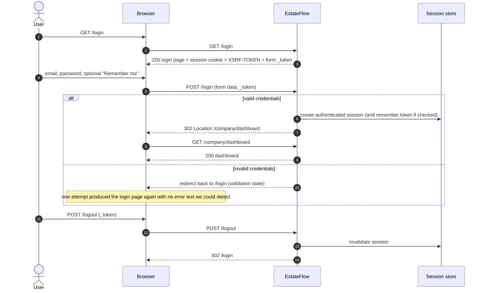

# 02 — Authentication, session and access

Observed: 2026-11-16. All checks used the single demo company account and a normal browser session. No credential attacks or fuzzing were performed.

---

## 1. Auth flow at a glance



---

## 2. Login page (`GET /login`)

Observed layout: split-screen auth shell. Left side is marketing copy for the product ("Manage every property, payment and client in one place", three feature bullets, copyright). Right side is the form card.

| Element | Details |
|---|---|
| Page title | `Sign in · Acme Realty` |
| H1 | `Sign in` |
| Subcopy | `Enter your credentials to access your account.` |
| Email | `input type=email name=email`, `autocomplete=username`, required |
| Password | `input type=password name=password`, `autocomplete=current-password`, required |
| Remember me | checkbox `name=remember`, optional |
| Forgot password | link to `/forgot-password` |
| Submit | `Sign in` button |
| CSRF | hidden `_token`; also `<meta name="csrf-token">` |
| Demo helper | A "Demo credentials" panel lists the Company Admin account and password. Clicking a row fills the form. This is demo-only behaviour; it must not exist in a production reimplementation. |
| Footer | `Your connection is secure and encrypted.` |

Other auth-page details: the same marketing shell is reused on `/forgot-password`.

---

## 3. Login request contract (observed)

`POST /login`

Accepted content types (both worked):

- `application/x-www-form-urlencoded`
- `multipart/form-data`

Fields:

| Field | Required | Notes |
|---|---|---|
| `_token` | yes | session CSRF token from the login form |
| `email` | yes | account email |
| `password` | yes | plaintext over HTTPS |
| `remember` | no | `1` when checked |

Observed valid response:

```http
HTTP/1.1 302 Found
Location: https://estateflow.devintime.com/company/dashboard
Set-Cookie: <redacted>
cache-control: no-cache, no-store, must-revalidate, max-age=0
x-ratelimit-limit: 10
x-ratelimit-remaining: 8
```

After the redirect, `GET /company/dashboard` returned **200** with the authenticated shell. Two login POSTs had been made at that point (the earlier invalid attempt and this valid one), which is consistent with `remaining: 8` out of 10.

Implications:

- Login is rate-limited (limit 10 per window; exact window not observable). A reimplementation should implement explicit throttling and lockout/backoff.
- The response sets a session cookie whose value is redacted by the capture tooling. The cookie's `HttpOnly`, `Secure`, `SameSite` and lifetime flags are therefore **not observed**.
- `document.cookie` exposes a readable `XSRF-TOKEN` cookie, while the session cookie is not readable from JS (consistent with `HttpOnly`). **Inferred**, not proven.
- With "Remember me" checked, the response still showed a single `set-cookie` header in the capture (values redacted). We could not confirm a separate remember cookie name or expiry. **ASSUMPTION:** framework-default remember-me behaviour (long-lived signed cookie that re-establishes the session).

### Invalid credentials (limited observation)

One POST with the correct email and a deliberately wrong password returned the login page again (`200`, final URL `/login`). The response body contained no text matching common error containers (`.invalid-feedback`, `.alert`, `.alert-danger`, `[role=alert]`), no visible error in the page text, and the email field was not repopulated. The demo may intentionally suppress the error, or render it in a component not captured.

**ASSUMPTION for reimplementation:** show a generic "These credentials do not match our records." message without revealing whether the email exists, keep the email value, and never echo the password. This is standard Laravel behaviour and the safest product choice; it is not a claim about what the demo displays.

No further invalid attempts were made, to respect the rate limit and the no-brute-force rule.

---

## 4. Session and guest guard

Observed:

| Check | Result |
|---|---|
| `GET /company/dashboard` while signed out | Redirected to `/login` (final `200`, login form) |
| `GET /company/leads` while signed out | Redirected to `/login` |
| `GET /forgot-password` while signed out | `200`, accessible |
| `GET /register` | `404` (self-registration is not exposed) |
| Authenticated `GET /company/*` | `200` |
| Logout | `POST /logout` with `_token` → lands on `/login`; subsequent company routes are guarded |

Guard behaviour is route-level, not just menu hiding: direct navigation to a protected URL redirects to the login screen.

Session details that remain unobserved: idle timeout, absolute lifetime, multi-device behaviour, session invalidation after password change, and remember-me duration. Treat these as implementation decisions in the plan, not as demo facts.

One anomalous observation: after the logout/guard checks, a later browser visit to `/company/dashboard` was authenticated again without an explicit login. The most likely explanation is a pre-existing remember-me cookie or a stale tab state; this was not reproducible on demand and is recorded as **not understood**, not as a product rule.

---

## 5. Logout

- Trigger: avatar menu → `Logout`, rendered as a `<form method="POST" action="/logout">` with a hidden `_token`.
- There are two logout forms in the DOM (desktop and collapsed/mobile menu), same action.
- Result: session invalidated server-side; redirect to `/login`.
- A direct `POST /logout` without a valid CSRF token is expected to be rejected (CSRF middleware); not separately exercised.

---

## 6. Forgot password (`GET/POST /forgot-password`)

Observed form:

| Field | Details |
|---|---|
| Page title | `Forgot password? · Acme Realty` |
| H1 | `Forgot password?` |
| Copy | `Enter your email and we will send you a link to reset your password.` |
| Email | `input type=email name=email`, `autocomplete=email`, required, placeholder `you@example.com` |
| Submit | `Send reset link` |
| Back link | `Back to sign in` |

`POST /forgot-password` is the form action. No email was sent during this pass; delivery, token lifetime and reset screen were **not observed**.

**ASSUMPTION:** standard tokenised email reset flow; responses should be enumeration-safe (always show "if that address exists, a link has been sent").

---

## 7. Profile (`/company/profile`)

Observed two forms.

### 7.1 Personal information

`POST /company/profile`, `enctype=multipart/form-data`.

| Label | Name | Type | Value in demo |
|---|---|---|---|
| Full name * | `name` | text | `Acme Realty` |
| Email * | `email` | email | `company@example.com` |
| Phone | `phone` | text | `09548888888` |
| Profile photo | `avatar` | file | — (JPEG/PNG/WebP, max 1 MB per helper copy) |

The left card shows the current avatar/initials, company name, email, role badge (`Company Admin`), branch/company, `Member since 24/09/2026`, `Last login 4 minutes ago`.

### 7.2 Change password

`POST /company/profile/password`.

| Label | Name | Type | Autocomplete |
|---|---|---|---|
| Current password | `current_password` | password | `current-password` |
| New password | `password` | password | `new-password` |
| Confirm password | `password_confirmation` | password | `new-password` |

Copy: "Use a strong password you do not use anywhere else." Submit: `Update password`. No success/error cycle was exercised.

Password change is also linked from the avatar menu as `Change password` → `/company/profile#security`.

---

## 8. Authorization model (surface)

- Every team member can be assigned roles and a branch.
- The Roles screen is a permission matrix grouped by module, with a per-group "Select all" and a global "Select all".
- Roles observed include full-access roles and limited roles; the exact seeded role names were not enumerated.
- The current user is a `Company Admin` and sees all sidebar groups.
- No permission-denied page was triggered. Menu filtering by permission is **inferred**; direct-route enforcement is **not observed**.
- Demo deletion is blocked independently of permissions (403), so it cannot be used to test role enforcement.

A reimplementation must enforce permissions server-side on every route and API call, not only hide menu entries.

---

## 9. Localization and direction

- Language switch lives in the topbar: `/language/ar`, `/language/en`, `/language/fr` (GET links).
- Each language has code, locale, direction (`ltr`/`rtl`) and default flag in Setup → Languages.
- The selected locale affects UI strings and CMS content editing (per-language tabs/`?locale=`).
- Auth pages are localized too (the login page observed in English).

---

## 10. Security observations relevant to reimplementation

Present in the demo and worth preserving:

- CSRF token on all state-changing forms and AJAX calls.
- Session-based auth with a route guard on `/company/*`.
- Login throttle (10 per window).
- Password hashing is implied by the framework but not observable.
- No public registration route.
- Logout is POST, not GET.
- Sensitive values (session cookie) are not exposed to JS.

Gaps/risks to improve in EstateVista:

- Do not copy the demo-credentials shortcut into production.
- Define explicit session lifetime, rotation on login, and invalidation on password change.
- Enforce role permissions server-side and add audit logging for privileged actions.
- Add email verification / password reset throttling and enumeration-safe responses.
- Consider 2FA for admin accounts (not present in the demo; do not implement unless requested as an addition).
- Keep the demo's “delete disabled” behaviour out of production; it is a demo guard, not a product feature.

---

## 11. Not observed (do not treat as absent)

- 2FA, SSO, passkeys.
- Email verification.
- Account lockout after N failures (only a rate limit header was seen).
- Reset email contents, token expiry, reset form.
- Session timeout and concurrent-session policy.
- Impersonation or “login as” features.
- API tokens / personal access tokens.
- Remember-me cookie name and lifetime.
