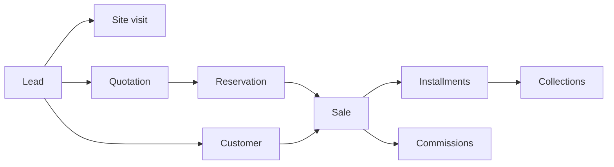

# 03-pages / Sales

Routes: `/company/leads`, `/company/visits`, `/company/customers`, `/company/quotations`, `/company/reservations`, `/company/sales`, `/company/installments`, `/company/collections`, `/company/commissions`.

This is the transaction spine of the product:



---

## 1. Leads (`/company/leads`)

### 1.1 List

Columns: `Lead`, `Interest`, `Budget`, `Next follow-up`, `Assigned to`, `Stage`, `Actions`.

Filters:

| Field | Options |
|---|---|
| `search` | name, phone or email |
| `status` | All stages, **Open leads**, New, Contacted, Qualified, Visit scheduled, Negotiation, Won, Lost |
| `source_id` | All sources, Website, Walk-in, Referral, Facebook, Phone call, Agent |
| `assigned_to` | Everyone + company users |

Rows: 20 per page. `Add lead` opens a modal.

### 1.2 Create/edit form (observed in full)

| Label | Name | Type | Rules/options |
|---|---|---|---|
| Name * | `name` | text | required |
| Phone | `phone` | text | required **when email is absent** |
| Email | `email` | email | required when phone is absent (server message observed) |
| Source | `source_id` | select | None, Website, Walk-in, Referral, Facebook, Phone call, Agent |
| Stage * | `status` | select | `new`, `contacted`, `qualified`, `visit_scheduled`, `negotiation`, `won`, `lost` |
| Assigned to | `assigned_to` | select | Unassigned + company users |
| Reason lost * | `lost_reason` | text | conditional: only for `lost` |
| Project | `project_id` | select | Any project + projects |
| Unit | `unit_id` | select | Any unit + units (with status in option text) |
| Budget min | `budget_min` | number | |
| Budget max | `budget_max` | number | |
| Notes | `notes` | textarea | |

Modal `#leadModal`, form `method=POST`, action supplied by `data-action` (`/company/leads` for create, `/company/leads/{uuid}` for update with `_method=PUT`). There is no HTML `required` attribute; validation is server-side.

Observed validation (422):

```json
{
  "message": "The name field is required. (and 1 more error)",
  "errors": {
    "name": ["The name field is required."],
    "phone": ["The phone field is required when email is not present."]
  }
}
```

### 1.3 Lead detail (`/company/leads/{uuid}`)

Header actions:

- `Convert to customer`
- `Quotation` → `/company/quotations/create?lead={uuid}`
- `Schedule follow-up`
- `Edit`
- `Schedule visit`
- `Mark as lost`
- `Delete` (demo-blocked)

Body: contact block (name, phone, email), owner, project/unit interest, budget, source, a horizontal stage stepper (New → Contacted → Qualified → Visit scheduled → Negotiation → Won), and an **Activity** timeline. Empty state: “No activity yet. Schedule a call, meeting…”.

Observed full CRUD cycle (temporary lead):

- create `POST /company/leads` → `200 {"message": "...", "redirect": ...}`, row appeared;
- update `POST /company/leads/{uuid}` with `_method=PUT` → `200 {"message": "Updated successfully."}`;
- delete `POST /company/leads/{uuid}` with `_method=DELETE` → `403 {"message": "This action is disabled in the demo version."}`.

The created lead remains in the demo: `ZZ RE Test Lead — Edited Then Deleted`, UUID `01a1e50a-ca97-73c8-8aa9-c791a1320f76`.

### 1.4 Lead business rules

- Changing stage to **Lost** requires `lost_reason`.
- A lead can be converted to a customer; the exact deduplication rule (same phone/email) was **not observed**.
- Won/lost leads remain visible under their stage filter.
- Follow-ups/activities are append-only history (inferred).

---

## 2. Site visits (`/company/visits`)

Filters:

| Field | Options |
|---|---|
| `when` | Upcoming, Past, All dates |
| `status` | All statuses, Scheduled, Completed, Cancelled, No-show |
| `project_id` | All projects |
| `salesperson_id` | Everyone + users |

Primary action: `Schedule visit` (modal; fields not fully captured).

**Observed context for the modal:** visits are linked to a lead/customer, a project and optionally a unit, with date/time and assigned salesperson. The demo notification feed showed messages such as “New visit request from Jhonatan Luna … wants to visit Lakeview Heights on 14/11/2026 6:06 PM.” Public website visit requests create these records (inferred).

Lists are card/schedule-oriented; no standard table was rendered in the captured page.

**ASSUMPTION fields:** `lead_id`/`customer_id`, `project_id`, `unit_id`, `visit_date`, `visit_time`, `salesperson_id`, `status`, `notes`.

---

## 3. Customers (`/company/customers`)

### 3.1 List

Columns: `Customer`, `Contact`, `Source`, `Units bought`, `Balance due`, `Status`, `Actions`.

Filters: `search` (name/phone/email), `source_id`, `type` (Individual/Company), `status` (Active/Inactive). 20 rows per page.

### 3.2 Add/edit modal (observed fields)

| Label | Name | Type | Notes |
|---|---|---|---|
| Full name * | `name` | text | required |
| Type * | `type` | select | `individual`, `company` |
| Phone * | `phone` | text | required |
| Alternate phone | `alternate_phone` | text | |
| Email | `email` | email | |
| National ID | `national_id` | text | |
| Date of birth | `date_of_birth` | date text | |
| Occupation | `occupation` | text | |
| Address | `address` | text | |
| City | `city` | text | |
| Country | `country` | text | |
| … | | | additional CRM fields exist below the captured fold |

The modal is `#customerModal`-style; `data-action`/`_method` conventions apply.

Customer detail is `/company/customers/{uuid}` (inferred from the list); its tabs/actions were **not captured**. Balance due is computed from sales/installments, and “Units bought” from sales.

---

## 4. Quotations (`/company/quotations`)

### 4.1 List

Columns: `Number`, `Prepared for`, `Unit`, `Date`, `Total`, `Status`, `Actions`.

Filters: `search` (number/name), `status` (Draft, Sent, Accepted, Rejected, Expired, Converted), `project_id`. 8 rows in demo.

### 4.2 Create (`/company/quotations/create`)

`POST /company/quotations`.

| Label | Name | Type | Options |
|---|---|---|---|
| Customer | `customer_id` | select | None + customers |
| Or lead | `lead_id` | select | None + leads (pre-filled from `?lead={uuid}`) |
| Unit | `unit_id` | select | project · unit · type · area |
| Unit price | `unit_price` | number | |
| Terms & conditions | `terms` | textarea | |
| — | `discount_amount` | number | discount |
| — | `tax_amount` | number | tax/VAT |
| Quotation date | `quotation_date` | date text | |
| Valid until | `valid_until` | date text | |
| Salesperson | `salesperson_id` | select | company users |

A quotation is for a single unit (no line-item repeater observed). Customer and lead are alternatives.

### 4.3 Lifecycle

`Draft → Sent → Accepted | Rejected | Expired`, then `Converted` to reservation/sale (inferred). Actions on the row/detail include view/print, edit, status change and convert; exact buttons were **not captured**. Number prefix is configured in Settings → Numbering.

---

## 5. Reservations (`/company/reservations`)

### 5.1 List

Columns: `Reservation`, `Customer`, `Unit`, `Booking money`, `Expires`, `Status`, `Actions`.

Filters: `search` (number/customer/unit), `status` (Active, Converted, Cancelled, Expired), `project_id`. 20 rows.

Primary action: `Reserve unit`.

### 5.2 Create modal (observed)

| Label | Name | Type |
|---|---|---|
| Customer * | `customer_id` | select |
| Unit * | `unit_id` | select |
| … | | additional fields below the captured fold |

The remaining modal fields were not captured. **ASSUMPTION** based on the table and reservation semantics: `booking_amount`, `expires_at`, `notes`. Booking money is shown in the list, and expiry drives the `Expired` status.

### 5.3 Actions/status

- Active reservation can be **converted to a sale** or **cancelled** (inferred).
- A unit should become `Reserved` while an active reservation exists (inferred from unit statuses).
- Booking money may be applied to the sale (not observed).

---

## 6. Sales (`/company/sales`)

### 6.1 List

Columns: `Sale`, `Customer`, `Unit`, `Net price`, `Collected`, `Status`, `Actions`.

Filters: `search`, `status` (Pending approval, Active, Fully paid, Cancelled), `project_id`, `salesperson_id`. 20 rows.

Primary action: `New sale`.

### 6.2 Create (`/company/sales/create`)

`POST /company/sales`.

| Label | Name | Type | Options/notes |
|---|---|---|---|
| Customer | `customer_id` | select | required in practice; None + customers |
| Unit | `unit_id` | select | required; available units |
| Agreement date | `agreement_date` | date text | |
| Salesperson | `salesperson_id` | select | company users |
| Sale price | `sale_price` | number | |
| Discount | `discount_amount` | number | |
| Tax / VAT | `tax_amount` | number | |
| Payment type | `payment_type` | radio | **Installments** or **Full payment** |
| Down payment | `plan[down_payment]` | number | when installments |
| Number of installments | `plan[number_of_installments]` | number | when installments |
| Frequency | `plan[frequency]` | select | Monthly, Quarterly, Half-yearly, Yearly |
| Plan start date / Payment due | `plan[start_date]` | date text | label concatenates “Plan start date” + “Payment due” |
| Due day of month | `plan[due_day]` | number | |
| Grace period | `plan[grace_days]` | number | days |
| Late fee | `plan[late_fee_type]` | select | No late fee, Fixed amount, Percentage of installment |
| Late fee value | `plan[late_fee_value]` | number | |
| Notes | `notes` | textarea | |

Schedule generation is server-side. The payment-type radio toggles the installment plan section.

### 6.3 Sale detail (`/company/sales/{uuid}`)

Header actions observed: `Receive payment`, `Handover`, `Cancel sale`, `Upload`.

Identity block: reference (`SAL-2026-00069`), unit + customer, project, date, salesperson, journal reference (`JE-2026-000933`), status badge, progress “$ 0 collected of $ 12,500,000 · 0%”.

Summary cards: `Net price`, `Collected`, `Balance due`, `Overdue`, `Next due`.

Payment schedule table (70 rows in the sample):

| # | Type | Due date | Amount | Late fee | Paid | Balance | Status | Actions |
|---|---|---|---|---|---|---|---|---|

- Row actions: `Send payment link`, `Reschedule`.
- Statuses: Upcoming, Due, Partly paid, Paid, Overdue, Waived, Cancelled (the same vocabulary as the Installments filter).
- Schedule meta example: “7-day grace · Late fee: $ 2” (fixed late fee).
- Handover is the final step after the balance is cleared (inferred; demo data was unpaid).
- Cancel sale should reverse/cancel outstanding installments (inferred; not exercised).

---

## 7. Installments (`/company/installments`)

Columns: `Due date`, `Customer`, `Sale`, `Amount`, `Paid`, `Balance`, `Status`, `Actions`.

Filters:

| Field | Options |
|---|---|
| `search` | sale or customer |
| `status` | All open, Upcoming, Due, Partly paid, Paid, Overdue, Waived, Cancelled |
| `project_id` | All projects |
| `date_from` / `date_to` | due-date range |

25 rows per page. Primary action: `Receive payment` (opens the collection modal). Row actions: receive payment, reschedule, waive (inferred from detail page).

A receipt can settle multiple installments; the collection form supports auto-allocation.

---

## 8. Collections (`/company/collections`)

Columns: `Receipt`, `Customer`, `Received into`, `Settles`, `Amount`, `Status`, `Actions`.

Filters: `search`, `customer_id`, `status` (Completed, Refunded, Voided), `date_from`, `date_to`. 20 rows.

Primary action: `Receive payment`. Modal actions observed: `Auto-allocate`, `Full amount`, `Save`.

Collection modal (observed controls):

- customer / sale context;
- amount and date;
- received-into account;
- allocation rows against open installments (auto-allocate or manual);
- reference/notes.

Field names were not fully captured; treat exact names as **ASSUMPTION**. The receipt status vocabulary is observed: `Completed`, `Refunded`, `Voided`.

Row actions: view, print/receipt, refund, void. Voiding/refunding requires a reason (inferred from the dedicated refunds module).

---

## 9. Commissions (`/company/commissions`)

Two tables on one page.

### 9.1 Rules

Columns: `Rule`, `Applies to`, `Commission`, `Becomes payable`, `Status`, `Actions`.

Filters: none captured for rules. Primary action `Add commission rule`.

### 9.2 Commission ledger

Columns: `Salesperson`, `Sale`, `Base amount`, `Commission`, `Paid`, `Status`, `Actions`.

Filters: `status` (Pending, Payable, Paid, Reversed), `salesperson_id`.

Rules define a rate/applicability and when commission becomes payable (e.g. on agreement or on full collection); exact rule fields were **not captured**. Ledger rows are generated per sale (inferred).

---

## 10. Cross-module effects

| Event | Effects |
|---|---|
| Lead converted | Customer record created; lead stage Won (inferred). |
| Quotation accepted | Can create a reservation/sale. |
| Reservation created | Unit → Reserved. |
| Sale created | Unit → Sold; installment schedule generated; journal entry posted (`JE-…`); commission ledgers generated. |
| Installment paid | Receipt created; sale `Collected` and balance update; commission may become payable. |
| Sale fully paid | Status `Fully paid`; handover enabled. |
| Sale cancelled | Installments cancelled; unit released (inferred). |
| Collection voided/refunded | Receipt status changes; balances re-open (inferred). |

---

## 11. Not observed

- Exact print/PDF layouts for quotations, receipts and sale agreements.
- Payment-gateway collection from a sale (only payment links exist).
- Reservation → sale conversion UI.
- Commission rule form fields.
- Bulk actions and exports.
- Notification triggers (assumed: assignment, stage change, due reminders).

---

## 12. Acceptance criteria for a reimplementation

1. Lead pipeline with seven stages, lost reason, source/assignee/project/unit interest, activity timeline and convert-to-customer.
2. Lead create/update/delete with server validation matching the observed 422 shape (including phone-or-email rule).
3. Site visits with upcoming/past views and statuses.
4. Customers with individual/company type, duplicate-safe contact fields, source and balance due.
5. Quotations with customer-or-lead, unit, price, discount, tax, dates, salesperson and statuses.
6. Reservations with booking money, expiry, active/expired/cancelled/converted states.
7. Sales with full/installment plans, schedule generation, late-fee configuration, collection, handover and cancellation.
8. Installment list with aging statuses and date filters.
9. Collections with auto-allocation, receipt status and refund/void flows.
10. Commission rules + ledger with payable/paid/reversed states.
11. All monetary rollups reconcile with the dashboard KPIs.
