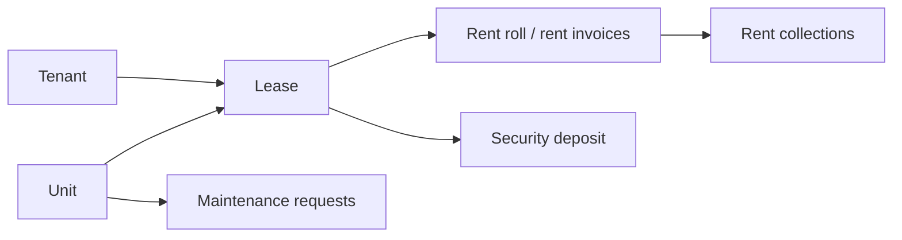

# 03-pages / Rental

Routes: `/company/occupancy`, `/company/tenants`, `/company/leases`, `/company/rent-roll`, `/company/rent-collections`, `/company/deposits`, `/company/maintenance`.



---

## 1. Occupancy (`/company/occupancy`)

- Portfolio-level rental occupancy view; primary action `New lease`.
- No standard table or KPI markup was captured; the page is a board/visualisation of units and their occupancy state.
- Unit rental states come from the unit status vocabulary (`Rented`, `Available`, …) plus active leases.

**Not observed:** exact grouping (project/building), occupancy percentage formula, filters.

---

## 2. Tenants (`/company/tenants`)

### 2.1 List

Columns: `Tenant`, `Contact`, `Current unit`, `Lease ends`, `Balance due`, `Status`, `Actions`.

Filters: `search` (name/phone/email), `occupancy` (All tenants, Current tenants, Without an active lease), `type` (Individual/Company), `status` (Active/Inactive). 20 rows.

Primary action: `Add tenant` (modal).

### 2.2 Add/edit modal (observed fields)

| Label | Name | Type | Options/notes |
|---|---|---|---|
| Full name * | `name` | text | required |
| Type * | `type` | select | `individual`, `company` |
| Phone * | `phone` | text | required |
| Alternate phone | `alternate_phone` | text | |
| Email | `email` | email | |
| ID document | `national_id_type` | select | None, National ID, Passport, Driving licence, Birth certificate, Trade licence |
| ID number | `national_id_number` | text | |
| Date of birth | `date_of_birth` | date text | |
| Occupation | `occupation` | text | |
| … | | | address/city/country/notes and active flag follow below the captured fold |

The tenant record is separate from the sales **customer** record, even when the same person/company appears in both.

---

## 3. Leases (`/company/leases`)

### 3.1 List

Columns: `Lease`, `Tenant`, `Unit`, `Term`, `Rent`, `Balance due`, `Status`, `Actions`.

Filters: `search` (lease/tenant/unit), `project_id`, `status` (Draft, Active, Expired, Terminated, Renewed). 20 rows.

Primary action: `New lease`.

### 3.2 Create (`/company/leases/create`)

`POST /company/leases`.

| Label | Name | Type | Options/notes |
|---|---|---|---|
| Unit | `unit_id` | select | project · unit · bedrooms · rent |
| Tenant | `tenant_id` | select | tenant · phone |
| Start date | `start_date` | date text | |
| End date | `end_date` | date text | |
| Rent frequency | `frequency` | select | Weekly, Monthly, Quarterly, Yearly |
| Rent per period | `rent_amount` | number | |
| Due day | `due_day` | number | day of period/month |
| Grace period | `grace_days` | number | days |
| Late fee | `late_fee_type` | select | No late fee, Fixed amount, Percentage of installment |
| Late fee value | `late_fee_value` | number | |
| Notice period | `notice_period_days` | number | days |
| Security deposit | `security_deposit_amount` | number | |
| Utilities included | `utilities_included[]` | checkboxes | Electricity, Water, Gas, Internet, Service charge, Parking |
| Terms & conditions | `terms` | textarea | |
| Activate immediately | `activate` | checkbox | creates an Active lease |

### 3.3 Lease detail (`/company/leases/{uuid}`)

Header actions observed: `Receive rent`, `Renew`, `Revise rent`, `Terminate lease`, `Upload`.

Identity: reference (`LSE-2026-00017`), unit/tenant, project/building, notice period, status, start/end dates and days remaining.

Summary: `Rent`, `Collected`, `Balance due`, `Overdue`, `Paid in advance`, `Next due`.

Rent schedule table (12 rows in sample):

| Period | Due date | Rent | Adjustments | Late fee | Paid | Balance | Status | Actions |
|---|---|---|---|---|---|---|---|---|

- Period label example: `Dec 2026`, `01/12/2026 – 31/12/2026`.
- Schedule meta example: “Due on day 5 · 5-day grace · Late fee: $ 5”.
- Row actions: `Extra charge`, `Discount`, `Waiver`.
- Statuses: Upcoming, Due, Partly paid, Paid, Overdue, Waived, Cancelled.

Renew creates a follow-on lease; terminate ends it early using the notice period; revise-rent changes future schedule amounts (inferred). None of these were exercised.

---

## 4. Rent roll (`/company/rent-roll`)

Columns: `Tenant`, `Unit`, `Period`, `Due date`, `Total`, `Paid`, `Balance`, `Status`, `Actions`.

Filters:

| Field | Options |
|---|---|
| `search` | lease, tenant or unit |
| `project_id` | All projects |
| `tenant_id` | All tenants |
| `status` | All statuses, All open, Upcoming, Due, Partly paid, Paid, Overdue, Waived, Cancelled |
| `date_from` / `date_to` | due-date range |

25 rows per page. Primary action: `Receive rent`.

---

## 5. Rent collections (`/company/rent-collections`)

Columns: `Receipt`, `Tenant`, `Received into`, `Settles`, `Amount`, `Status`, `Actions`.

Filters: `search`, `tenant_id`, `status` (Completed, Voided), `date_from`, `date_to`. 20 rows.

Primary action: `Receive rent`; modal actions `Auto-allocate`, `Save`.

Same receipt mechanics as sale collections, but scoped to rent invoices. Voiding a receipt re-opens the rent balance (inferred).

---

## 6. Security deposits (`/company/deposits`)

Columns: `Tenant`, `Lease`, `Required`, `Received`, `Deducted`, `Refunded`, `Held now`, `Status`, `Actions`.

Filters: `search` (lease/tenant), `status` (Awaiting settlement, To collect, Held, Settled). 20 rows.

Status vocabulary implies the lifecycle:

```
Awaiting settlement → To collect → Held → Settled
```

Actions (observed button set on the page): `Filter`, `Save` plus row actions. Exact labels per row were not captured. Expected operations: record receipt, deduct for damage/dues, refund, settle. **ASSUMPTION** for the exact modal fields.

---

## 7. Maintenance (`/company/maintenance`)

Columns: `Request`, `Unit`, `Priority`, `Assigned to`, `Cost`, `Status`, `Actions`.

Filters:

| Field | Options |
|---|---|
| `search` | number, issue, unit or tenant |
| `project_id` | All projects |
| `category_id` | All categories, Plumbing, Electrical, Painting, Appliance, Cleaning, Other |
| `priority` | All priorities, Low, Medium, High, Urgent |
| `status` | All statuses, Open, Assigned, In progress, Completed, Closed, Cancelled |

14 rows in demo. Primary action: `Log request`.

Status lifecycle: `Open → Assigned → In progress → Completed → Closed`, with `Cancelled` as an exit. The page exposes multiple modal forms (log request, assign, complete with cost, cancel); exact fields were **not captured**.

**ASSUMPTION fields:** unit/tenant, category, title/description, priority, assigned to (team member/contractor), reported date, scheduled date, cost, notes, photos.

---

## 8. Cross-module effects

| Event | Effect |
|---|---|
| Lease activated | Unit → Rented; rent schedule generated; deposit record created. |
| Rent collected | Rent invoice balance updates; receipt and journal posted. |
| Deposit received | Deposit `Received`/`Held` increases; cash/bank increases. |
| Deposit deducted | `Deducted` increases; held balance decreases; income or expense offset (inferred). |
| Lease terminated | Unit released; final settlement/deposit refund; future invoices cancelled (inferred). |
| Maintenance completed | Cost recorded as expense (inferred). |

---

## 9. Not observed

- Occupancy board layout and percentages.
- Lease renewal/termination/rent-revision forms.
- Deposit deduction/refund forms.
- Maintenance request/assignment/completion forms.
- Tenant detail page.
- Recurring rent generation job/automation.

---

## 10. Acceptance criteria for a reimplementation

1. Tenants with individual/company type, ID document, contact and active state.
2. Leases with unit/tenant, term, frequency, rent, due day, grace, late fee, notice, deposit, utility inclusions and activation.
3. Rent schedule generated from the lease, with extra charge/discount/waiver adjustments.
4. Lease actions: receive rent, renew, revise rent, terminate.
5. Rent roll with all open/aging statuses and date filtering.
6. Rent collections with auto-allocation, receipt and void.
7. Security deposit ledger reconciling required/received/deducted/refunded/held.
8. Maintenance requests with categories, priority and full status lifecycle.
9. Unit status changes (Rented/Available) driven by lease lifecycle.
