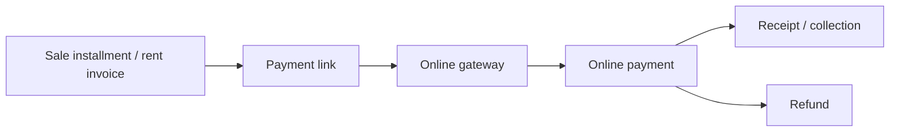

# 03-pages / Payments

Routes: `/company/payment-links`, `/company/online-payments`, `/company/refunds`.

---

## 1. Payment links (`/company/payment-links`)

Columns: `Customer`, `Pays for`, `Amount`, `Expires`, `Status`, `Actions`.

Filters:

| Field | Options |
|---|---|
| `search` | description or customer |
| `customer_id` | All customers |
| `status` | Active, Paid, Expired, Cancelled |

18 rows in demo. Primary action: `New payment link` (modal).

**Observed semantics:** a link is tied to a customer and a payable (“Pays for”), has an amount and an expiry, and moves through Active → Paid/Expired/Cancelled. Links are generated from installments/rent (“Send payment link”) and can also be created directly.

**ASSUMPTION fields** (modal not fully captured): customer, payable reference (sale installment or rent invoice), description, amount, expiry date, notes. The public URL and copy/share action are implied by the feature.

---

## 2. Online payments (`/company/online-payments`)

Columns: `Reference`, `Customer`, `Gateway`, `Amount`, `Status`, `Actions`.

Filters:

| Field | Options |
|---|---|
| `search` | receipt or transaction ID |
| `gateway` | All gateways, **SSLCommerz**, **Stripe** |
| `status` | Pending, Completed, Failed, Refunded, Voided |

12 rows in demo. Header actions: `Payment links`, `Gateway settings` (→ `/company/settings?tab=payments`).

Status lifecycle: `Pending → Completed | Failed`, then `Refunded` or `Voided` (refund creates a refund record; void reverses the receipt). Exact action labels were not captured.

Gateway configuration (observed in Settings → Payment gateways):

- SSLCommerz: enabled, Store ID, Store password, Deposit account, Sandbox mode.
- Stripe: enabled, Secret key, Webhook signing secret, Deposit account.
- Default link validity (days), “email a receipt after every payment”.

This confirms gateway callbacks/webhooks are part of the real product. They were not exercised.

---

## 3. Refunds (`/company/refunds`)

Columns: `Refund`, `Customer`, `Original receipt`, `Reason`, `Amount`, `Status`.

Filters:

| Field | Options |
|---|---|
| `search` | refund or receipt no. |
| `status` | Processing, Completed, Failed |
| `date_from` / `date_to` | date range |

2 rows in demo. No primary “new refund” button was observed; refunds are initiated from a collection/online payment (`Refund` action), then tracked here.

Status lifecycle: `Processing → Completed | Failed`. A refund references exactly one original receipt and carries a reason.

---

## 4. Cross-module effects

| Event | Effect |
|---|---|
| Payment link paid | Online payment `Completed`; receipt created; installment/rent balance updated. |
| Gateway failure | Online payment `Failed`; no receipt. |
| Refund completed | Original receipt `Refunded`; installment/rent balance re-opened (inferred). |
| Receipt voided | Balance re-opened; audit entry written. |

**ASSUMPTION:** receipt and journal postings happen on gateway confirmation (webhook), not on redirect, and are idempotent by gateway transaction ID. This is standard practice; the demo did not exercise a payment.

---

## 5. Not observed

- Payment-link modal fields and public checkout page.
- Gateway redirect/callback/webhook handling.
- Refund initiation form and reason taxonomy.
- Reconciliation/import of gateway settlements.
- Receipt email template/delivery.

---

## 6. Acceptance criteria for a reimplementation

1. Payment links with customer, payable, amount, expiry and active/paid/expired/cancelled states.
2. Online payment records with gateway, reference, amount and full status lifecycle.
3. Gateway settings for at least Stripe (and a second provider only if required); secrets stored server-side, never exposed to the client.
4. Refunds tracked against an original receipt with reason and status.
5. Receipt/balance updates are idempotent and auditable.
6. No demo-style shortcuts (e.g. hard-coded gateway credentials or test bypasses) in production.
