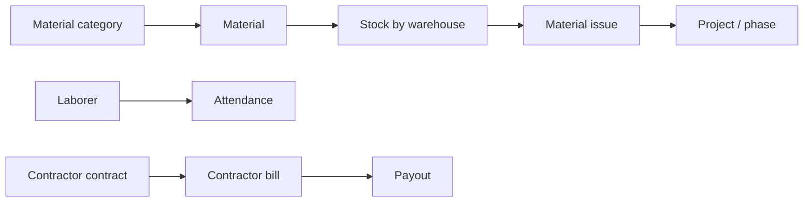

# 03-pages / Construction

Routes: `/company/materials`, `/company/inventory`, `/company/material-issues`, `/company/laborers`, `/company/attendance`, `/company/contracts`.

---

## 1. Materials (`/company/materials`)

Columns: `Material`, `Category`, `In stock`, `Reorder level`, `Average cost`, `Stock value`, `Status`, `Actions`.

Filters:

| Field | Options |
|---|---|
| `search` | name or SKU |
| `material_category_id` | All categories, Bricks & blocks, Cement & aggregates, Electrical, Finishing, Plumbing & sanitary, Steel |
| `stock` | All stock levels, Low stock, Out of stock |

14 rows in demo. Actions: `Stock` (→ `/company/inventory`), `Add material` (modal).

Observed material examples (from issue/PO selectors): Portland cement (50 kg) `CEM-50`, Stone chips ¾" `STN-34`, Sylhet sand `SND-SYL`, MS rod 60 grade `ROD-60`, Binding wire `BWR-01`, First class bricks `BRK-1C`, AAC block 6" `AAC-6`, Electrical cable 2.5 rm `CBL-25`, Switch board set `SWB-01`, GI pipe 1" `GIP-1`, Floor tiles 24"×24" `TIL-24`, Sanitary fittings set `SAN-STD`, Plastic emulsion paint `PNT-EM`.

**ASSUMPTION fields** for Add material: name, SKU/code, category, unit, reorder level, average/standard cost, opening stock, notes, active. Exact names were not captured.

---

## 2. Stock (`/company/inventory`)

Columns: `Material`, one column per warehouse (`Lakeview site store`, `Main Store`, `Skyline site store`), `Total`, `Reorder level`, `Stock value`, `Status`, `Actions`.

Filters: `search`, `warehouse_id`, `stock` (All stock levels, In stock, Low stock, Out of stock). 14 rows.

Actions: `Stock movements`, `Transfer`, `Adjust stock`.

- **Stock movement**: in/out record with material, warehouse, quantity, reference/source, date, user. Exact form not captured.
- **Transfer**: from warehouse → to warehouse, material + quantity, date, note. Modal fields not fully captured.
- **Adjust stock**: material, warehouse, counted quantity or delta, reason, date.

Stock status is derived from total on hand vs reorder level (`Low stock`, `Out of stock`). Average cost is used for stock valuation (inferred).

Warehouses (`/company/warehouses`) is a card page: name, code, type (Central store / Site store), project, address, stock value, movement count, `View stock`. Fields observed: name*, code*, project; **ASSUMPTION** type, address, active.

---

## 3. Material issues (`/company/material-issues`)

### 3.1 List

Columns: `Number`, `Project`, `Location`, `Date`, `Requested by`, `Cost`, `Status`, `Actions`.

Filters:

| Field | Options |
|---|---|
| `search` | number |
| `project_id` | All projects |
| `warehouse_id` | All warehouses |
| `status` | Pending approval, Approved, Issued, Rejected, Cancelled |

18 rows. Primary action: `New material issue`.

Status lifecycle: `Pending approval → Approved → Issued`, with `Rejected`/`Cancelled` exits. Cost is the value of the materials released.

### 3.2 Create (`/company/material-issues/create`)

`POST /company/material-issues`.

| Label | Name | Type | Options/notes |
|---|---|---|---|
| Project * | `project_id` | select | projects |
| Construction phase | `construction_phase_id` | select | Not linked, Land preparation, Foundation, Structure, Brick work, Plumbing, Electrical, Doors & windows, Plaster, Flooring, Painting, Finishing, External works, Handover |
| Building | `building_id` | select | project buildings |
| Floor | `floor_id` | select | project floors |
| Issue from * | `warehouse_id` | select | warehouses |
| Issue date | `issue_date` | date text | |
| Purpose / notes | `notes` | textarea | |
| Item material | `items[0][material_id]` | select | material + SKU |
| Item quantity | `items[0][quantity]` | number | |

The item block is repeatable (`items[n][…]`) with add/remove rows (inferred from the `[0]` index). Only `material_id` and `quantity` were observed per line.

---

## 4. Laborers (`/company/laborers`)

Columns: `Laborer`, `Category`, `Rate`, `Earned`, `Paid`, `Due`, `Status`, `Actions`.

Filters:

| Field | Options |
|---|---|
| `search` | name, code or phone |
| `labor_category_id` | All categories, Mason, Carpenter, Electrician, Plumber, Painter, Helper |
| `worker_type` | All worker types, Daily, Monthly |
| `status` | Active, Inactive |

12 rows. Actions: `Take attendance`, `Add laborer` (modal).

Rate semantics: daily or monthly wage; `Earned` from attendance, `Paid` from payouts, `Due = Earned − Paid` (inferred, matches the columns).

**ASSUMPTION fields:** name*, code, category, worker type, rate, phone, project, join date, active, notes.

---

## 5. Labor attendance (`/company/attendance`)

Filters: `project` (required, one of the six projects), `date` (single day). Actions: `Attendance history`, `Laborers`, `Load`, `Mark all present`, `Save attendance`.

Table columns: `Laborer`, `Attendance`, `Hours`, `OT hours`, `Construction phase`, `Amount`.

- One row per laborer on the selected project/date.
- Attendance values likely Present / Absent / Half day / Leave (not fully captured).
- Amount is computed from attendance/hours/OT and the laborer’s rate.
- `Mark all present` is a bulk convenience.
- `Monthly register` exists on HR attendance, not here; labor attendance focuses on project/day.

**ASSUMPTION:** saving attendance is idempotent per laborer+date, and locked once payroll/payout is processed.

---

## 6. Contracts (`/company/contracts`)

Columns: `Contract`, `Contractor`, `Project`, `Contract value`, `Billed`, `Paid`, `Status`, `Actions`.

Filters: `search` (number/title), `contractor_id`, `project_id`, `status` (Draft, Active, Completed, Terminated). 8 rows.

Primary action: `New contract`.

**Observed semantics:** a contractor contract has a value, is billed incrementally and paid through payouts. Number prefix `CON-` (4 digits, never resets), contractor bills `BILL-` (5 digits, yearly reset).

`New contract` form was not captured. **ASSUMPTION fields:** contractor, project, title, contract date, start/end, contract value, retention %, terms, status, documents.

---

## 7. Cross-module effects

| Event | Effect |
|---|---|
| PO received | Stock increases at the destination warehouse. |
| Material issue approved/issued | Stock decreases; project cost increases. |
| Stock adjustment | Stock value and average cost update; audit record. |
| Attendance saved | Laborer earned amount increases; project cost increases. |
| Contractor bill approved | Payable increases; expense/capitalised cost posted. |
| Payout to laborer/contractor | Paid amount increases; payable/advance decreases. |

---

## 8. Not observed

- Material create/edit form.
- Stock movement/transfer/adjustment forms.
- Material issue approval workflow (requester vs approver).
- Laborer create/edit form and attendance history view.
- Contract and contractor-bill forms.
- Contractor detail page.

---

## 9. Acceptance criteria for a reimplementation

1. Material catalogue with SKU, category, unit, reorder level and cost.
2. Per-warehouse stock balances, total, valuation and low/out-of-stock status.
3. Stock transfer, adjustment and an auditable movement ledger.
4. Material issues with project/phase/building/floor, warehouse, line items and approval → issue lifecycle.
5. Laborers with daily/monthly rates and earned/paid/due totals.
6. Daily project attendance with hours, OT, phase and computed amount, plus bulk mark-present.
7. Contractor contracts with value/billed/paid/status and contractor bills.
8. All stock and cost movements reconcile with finance/accounting.
