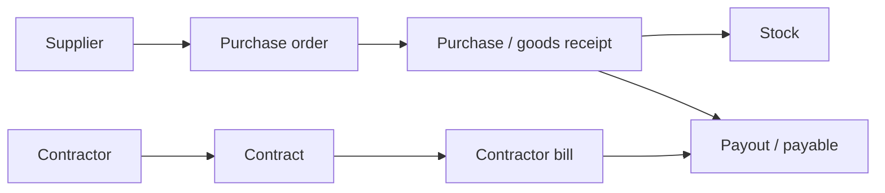

# 03-pages / Purchasing

Routes: `/company/purchase-orders`, `/company/purchases`, `/company/suppliers`, `/company/contractors`.

---

## 1. Purchase orders (`/company/purchase-orders`)

### 1.1 List

Columns: `Number`, `Supplier`, `Project`, `Order date`, `Received`, `Total`, `Status`, `Actions`.

Filters:

| Field | Options |
|---|---|
| `search` | number |
| `supplier_id` | All suppliers |
| `project_id` | All projects |
| `status` | Draft, Approved, Partly received, Received, Cancelled |

16 rows. Primary action: `New purchase order`.

Lifecycle: `Draft → Approved → Partly received → Received`, with `Cancelled` as an exit. “Received” tracks the received quantity against ordered quantity.

### 1.2 Create (`/company/purchase-orders/create`)

`POST /company/purchase-orders`.

| Label | Name | Type | Options/notes |
|---|---|---|---|
| Supplier | `supplier_id` | select | suppliers |
| Project | `project_id` | select | **General stock** or a project |
| Deliver to | `warehouse_id` | select | **Decide when received** or a warehouse |
| Order date | `order_date` | date text | |
| Expected delivery | `expected_date` | date text | |
| Item material | `items[0][material_id]` | select | material + SKU |
| Item description | `items[0][description]` | text | free-text line description |
| Item quantity | `items[0][quantity]` | number | |
| Item unit cost | `items[0][unit_cost]` | number | |
| Notes & terms | `notes` | textarea | |
| — | `discount_amount` | number | header discount |
| — | `tax_amount` | number | header tax |

Line items are repeatable (`items[n]`). Total is computed from quantity × unit cost, less discount, plus tax. Approval is required above a configured threshold (inferred from the Approvals module's “Purchase order” type).

---

## 2. Purchases / goods receipts (`/company/purchases`)

### 2.1 List

Columns: `Number`, `Supplier`, `Project`, `Date`, `Total`, `Balance due`, `Status`, `Actions`.

Filters:

| Field | Options |
|---|---|
| `search` | number or supplier invoice |
| `supplier_id` | All suppliers |
| `project_id` | All projects |
| `status` | Draft, Received, Cancelled |
| `payment_status` | Any, Unpaid, Partly paid, Paid |

12 rows. Primary action: `New purchase`.

### 2.2 Create (`/company/purchases/create`)

`POST /company/purchases`.

| Label | Name | Type | Options/notes |
|---|---|---|---|
| Supplier | `supplier_id` | select | suppliers |
| Supplier invoice no. | `supplier_invoice_number` | text | vendor document reference |
| Receive into | `warehouse_id` | select | warehouses |
| Project | `project_id` | select | General stock or a project |
| Purchase date | `purchase_date` | date text | |
| Payment due | `due_date` | date text | |
| Item material | `items[0][material_id]` | select | material + SKU |
| Item description | `items[0][description]` | text | |
| Item quantity | `items[0][quantity]` | number | |
| Item unit cost | `items[0][unit_cost]` | number | |
| Notes | `notes` | textarea | |
| — | `discount_amount` | number | |
| — | `tax_amount` | number | |

Saving a received purchase increases stock at the destination warehouse, updates average cost and creates a supplier payable. Paying the supplier happens through **Payouts** (payee type Supplier).

Statuses and payment statuses are independent: `Draft/Received/Cancelled` and `Unpaid/Partly paid/Paid`.

---

## 3. Suppliers (`/company/suppliers`)

### 3.1 List

Columns: `Supplier`, `Contact`, `Purchases`, `Payable`, `Status`, `Actions`.

Filters: `search` (name/code/phone), `type` (Material supplier, Service provider, Equipment rental, Other), `status` (Active/Inactive). 7 rows.

Primary action: `Add supplier` (modal).

### 3.2 Add/edit modal (observed in full)

| Label | Name | Type | Options/notes |
|---|---|---|---|
| Name * | `name` | text | |
| Code | `code` | text | auto/`SUP-####` convention |
| Type * | `type` | select | `material_supplier`, `service_provider`, `equipment_rental`, `other` |
| Contact person | `contact_person` | text | |
| Phone | `phone` | text | |
| Email | `email` | email | |
| Address | `address` | text | |
| Tax / VAT number | `tax_number` | text | |
| Notes | `notes` | textarea | |
| Active | `is_active` | checkbox | |

`Purchases` and `Payable` are computed aggregates.

---

## 4. Contractors (`/company/contractors`)

Columns: `Contractor`, `Trade`, `Contact`, `Contracts`, `Contract value`, `Payable`, `Status`, `Actions`.

Filters: `search`, `trade_id` (All trades, Civil, Electrical, Plumbing, Finishing, Steel), `status` (Active/Inactive). 5 rows.

Primary action: `Add contractor` (modal; fields not fully captured).

**ASSUMPTION fields:** name*, code, trade, contact person, phone, email, address, tax number, notes, active. Mirror the supplier form with trade instead of type.

Contractors are engaged through **Contracts** (Construction module) and paid through **Payouts** (payee type Contractor).

---

## 5. Cross-module effects

| Event | Effect |
|---|---|
| PO approved | Commitment recorded; stock not yet increased. |
| Goods received | Stock increases; purchase `Received`; supplier payable created. |
| Supplier payment | Payable decreases; payout posted to bank/cash. |
| Contractor bill approved | Contractor payable increases; project cost posted. |
| Contractor payment | Payable decreases; payout posted. |

---

## 6. Not observed

- Purchase-order approval flow and partial receipt UI.
- Purchase returns (prefix `PRN-` exists in numbering, page not in sidebar).
- Supplier/contractor detail pages.
- Purchase payment allocation UI.
- Contractor bill create/approve form.

---

## 7. Acceptance criteria for a reimplementation

1. Suppliers with type, contact, tax number and active state.
2. Contractors with trade and the same contact/payable semantics.
3. Purchase orders with line items, project/general-stock target, warehouse, dates, discount/tax and draft→approved→received lifecycle.
4. Purchases with supplier invoice, receiving warehouse, line items, due date and payment status.
5. Receiving goods updates stock, average cost and supplier payable atomically.
6. PO → purchase conversion (full or partial) without double-counting stock.
7. Payments recorded as payouts and reflected in supplier/contractor payable balances.
