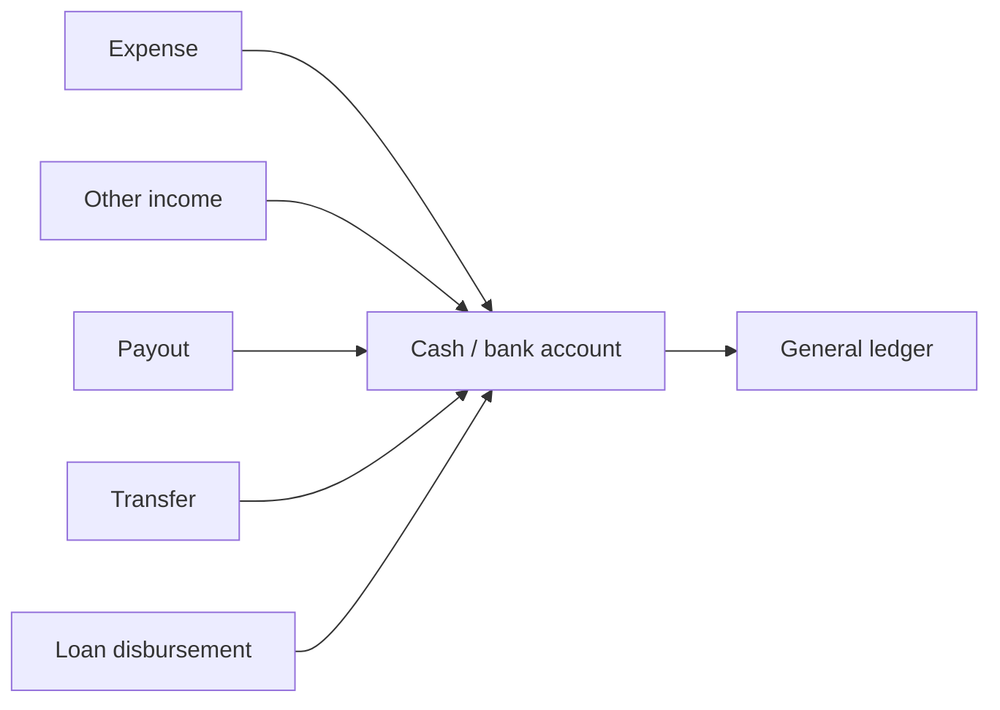

# 03-pages / Finance

Routes: `/company/expenses`, `/company/incomes`, `/company/payouts`, `/company/transfers`, `/company/loans`, `/company/expense-categories`.

---

## 1. Expenses (`/company/expenses`)

### 1.1 List

Columns: `Expense`, `Category`, `Project`, `Paid from`, `Amount`, `Status`, `Actions`.

Filters:

| Field | Options |
|---|---|
| `search` | number or reference |
| `expense_category_id` | All categories, Equipment rental, Land & registration, Marketing, Office & administration, Permits & approvals, Site expenses, Transport & carriage, Utilities |
| `project_id` | All projects |
| `status` | Draft, Approved, Cancelled |
| `date_from` / `date_to` | date range |

20 rows. Actions: `Categories` (→ `/company/expense-categories`), `Record expense` (modal `#expenseModal`).

### 1.2 Record expense modal (observed in full)

| Label | Name | Type | Options/notes |
|---|---|---|---|
| Category * | `expense_category_id` | select | expense categories |
| Date | `expense_date` | date text | |
| Project | `project_id` | select | **Company overhead** or a project |
| Phase | `construction_phase_id` | select | — + construction phases (project-dependent) |
| Building | `building_id` | select | — + project buildings |
| Amount | `amount` | number | |
| Tax / VAT | `tax_amount` | number | |
| Payment method | `payment_method_id` | select | —, Cash, Bank Transfer, Cheque, Mobile Banking, SSLCommerz, Stripe |
| Paid from | `paid_from_account_id` | select | Cash/Bank/Current/Escrow accounts |
| Vendor | `supplier_id` | select | None + suppliers |
| Reference | `reference` | text | receipt or voucher no. |
| Notes | `notes` | textarea | |

Saving posts a journal entry (expense/asset debit, cash/bank credit). Expenses above the approval threshold become approval requests (inferred from the Approvals module's “Expense” type).

### 1.3 Expense categories (`/company/expense-categories`)

Columns: `Category`, `Budget category`, `Ledger account`, `Expenses`, `Total spent`, `Status`.

8 categories in demo. `Add category` modal fields were not fully captured; **ASSUMPTION:** name, budget category (operating/capital/etc.), ledger account, active.

---

## 2. Other income (`/company/incomes`)

### 2.1 List

Columns: `Income`, `Income account`, `Received from`, `Received into`, `Amount`, `Status`, `Actions`.

Filters:

| Field | Options |
|---|---|
| `search` | number, payer or reference |
| `account_id` | income ledger accounts (4000, 4100, 4200, 4300, 4310, 4320, 4400) |
| `project_id` | All projects |
| `status` | Posted, Voided |
| `date_from` / `date_to` | date range |

20 rows. Primary action: `Record income`.

### 2.2 Record income modal (observed)

| Label | Name | Type | Options |
|---|---|---|---|
| Income account | `account_id` | select | 4000 Income, 4100 Flat Sales, 4200 Rental Income, 4300 Other Income, 4310 Bank Interest, 4320 Parking & Service Fees, 4400 Late Fee Income |
| Date | `income_date` | date text | |
| Received from | `payer_name` | text | e.g. scrap buyer, bank |
| Amount | `amount` | number | |
| Payment method | `payment_method_id` | select | —, Cash, Bank Transfer, Cheque, Mobile Banking |
| Received into | `deposit_account_id` | select | cash/bank accounts |
| Project | `project_id` | select | Company level or project |
| Reference | `reference` | text | |
| Notes | `notes` | text | |

Void modal: `Reason *` textarea (“e.g. Cheque bounced, entered twice”). Voiding posts a reversing journal entry and keeps the original (standard accounting behaviour).

---

## 3. Payouts (`/company/payouts`)

Columns: `Payout`, `Payee`, `Paid from`, `Settles`, `Amount`, `Status`, `Actions`.

Filters:

| Field | Options |
|---|---|
| `search` | number or reference |
| `payee_type` | Supplier, Contractor, Laborer, Salesperson, Tenant, Employee |
| `status` | Posted, Voided |
| `date_from` / `date_to` | date range |

20 rows. Primary action: `New payout`.

Payout modal (observed):

| Label | Name | Type | Options |
|---|---|---|---|
| Payee type | `payee_type` | select | supplier, contractor, laborer, salesperson, tenant, employee |
| Payee | `payee_id` | select | dynamically filtered by payee type |
| Payment date | `paid_on` | date text | |
| Payment method | `payment_method_id` | select | —, Cash, Bank Transfer, Cheque, Mobile Banking, SSLCommerz, Stripe |
| Paid from | `account_id` | select | cash/bank accounts |
| Reference | `reference` | text | cheque or transaction no. |
| Notes | `notes` | text | |

Amount and “settles” allocation rows are populated dynamically after choosing a payee (not present in the raw modal HTML) — **not captured**. Semantics: a payout can settle one or more payables/dues for the selected payee (supplier bills, contractor bills, laborer dues, salesperson commissions, tenant deposit refunds, employee advances).

---

## 4. Bank & cash (`/company/transfers`)

### 4.1 Account summary

Cards for each cash/bank account:

- code + name, institution/branch/masked account number for bank accounts;
- current balance;
- `Statement` link.

Observed accounts: `1100 · Cash` ($14,842,223), `1200 · Bank` ($1,476,381,223), `1210 · Dutch-Bangla Bank — Current` ($19,100,000), `1220 · BRAC Bank — Escrow` ($15,564,000).

Header actions: `Add bank account`, `New transfer`.

### 4.2 Transfers

Columns: `Transfer`, `From`, `To`, `Amount`, `Status`, `Actions`.

Filters: `search`, `account_id`, `status` (Posted, Voided), `date_from`, `date_to`.

15 rows. Transfer modal (observed):

| Label | Name | Type |
|---|---|---|
| From account | `from_account_id` | select (with balances) |
| To account | `to_account_id` | select |
| Amount | `amount` | number |
| Date | `transfer_date` | date text |
| Reference | `reference` | text |
| Notes | `notes` | text |

Void modal: `Reason *`. A transfer posts two journal lines (cash/bank out, cash/bank in).

`Add bank account` opens the chart-of-accounts account modal (see Accounting) with bank-specific fields.

---

## 5. Loans (`/company/loans`)

Columns: `Loan`, `Terms`, `Principal`, `Repaid`, `Next due`, `Status`.

Filters: `search` (number/lender), `status` (Active, Closed). 3 rows. Primary action: `New loan`.

New loan modal (observed in full):

| Label | Name | Type | Options/notes |
|---|---|---|---|
| Lender | `lender_name` | text | e.g. City Bank PLC |
| Lender type | `lender_type` | select | bank, nbfi, director, other |
| Principal | `principal` | number | |
| Interest rate | `interest_rate` | number | |
| Interest method | `interest_method` | select | Reducing balance (EMI), Flat rate |
| Repayment frequency | `payment_frequency` | select | Monthly, Quarterly, Half-yearly, Yearly |
| Number of installments | `installments_count` | number | |
| Disbursement date | `start_date` | date text | |
| Received into | `disbursement_account_id` | select | cash/bank accounts |
| Liability account | `liability_account_id` | select | 2000 Liabilities, 2100 AP, 2200 Loans, 2300 Customer Deposits, 2400 Security Deposits, 2500 Retention, 2600 Salaries Payable, 2700 Tax Payable |
| Notes | `notes` | text | sanction letter no., security, covenants |

Loan schedule generation and repayment UI were **not captured**. `Repaid` and `Next due` imply an amortisation schedule and repayments via payouts or a dedicated repayment action.

---

## 6. Cross-module effects

| Event | Effect |
|---|---|
| Expense saved | Cash/bank decreases; expense or WIP/asset increases; project cost updates. |
| Other income saved | Cash/bank increases; income ledger credited. |
| Payout saved | Cash/bank decreases; payable/dues decrease. |
| Transfer saved | One account decreases, another increases; no P&L impact. |
| Loan disbursed | Cash/bank increases; loan liability increases; schedule created. |
| Void | Reversing journal; original remains visible. |

All finance actions are expected to write **audit log** entries and be visible in the general ledger.

---

## 7. Not observed

- Expense approval threshold and approver routing.
- Payout amount/allocation UI.
- Bank statement/reconciliation.
- Loan repayment and interest schedule UI.
- Expense-category create/edit modal fields.
- Multi-currency revaluation.

---

## 8. Acceptance criteria for a reimplementation

1. Expenses with category, project/phase/building, amount, tax, payment method, paid-from account, vendor, reference and notes.
2. Expense categories with ledger mapping and budget category.
3. Other income with income ledger, payer, deposit account and project.
4. Payouts for all six payee types with allocation to dues.
5. Bank/cash accounts with running balances and transfers.
6. Loans with lender, principal, interest method, frequency, schedule, disbursement and liability account.
7. Void flows that reverse rather than delete.
8. Every posting balanced and traceable to the general ledger and audit log.
