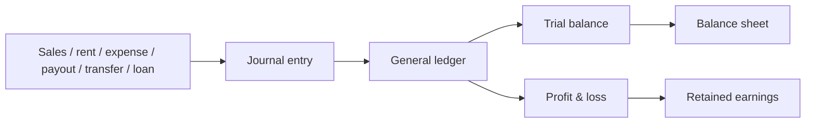

# 03-pages / Accounting

Routes: `/company/accounts`, `/company/journals`, `/company/reports/*`.

---

## 1. Chart of accounts (`/company/accounts`)

### 1.1 List

Columns: `Account`, `Sub-type`, `Balance`, `Status`, `Actions`.

Filters: `search` (code/name), `type` (Assets, Liabilities, Equity, Income, Expenses), `status` (Active/Inactive). 42 accounts.

Header action: `Trial balance`.

Observed accounts (sample, hierarchical codes):

| Code | Name | Type |
|---|---|---|
| 1000 | Assets | asset |
| 1100 | Cash | asset / cash |
| 1200 | Bank | asset / bank |
| 1210 | Dutch-Bangla Bank — Current | asset / bank |
| 1220 | BRAC Bank — Escrow | asset / bank |
| 1300 | Accounts Receivable | asset / receivable |
| 1310 | Rent Receivable | asset / receivable |
| 1400 | Inventory | asset |
| 1500 | Work in Progress | asset |
| 1600 | Employee Advances | asset |
| 2000 | Liabilities | liability |
| 2100 | Accounts Payable | liability / payable |
| 2200 | Loans | liability / loan |
| 2300 | Customer Deposits | liability |
| 2400 | Security Deposits Held | liability |
| 2500 | Retention Payable | liability |
| 2600 | Salaries Payable | liability |
| 2700 | Tax Payable | liability |
| 3000 | Equity | equity |
| 3100 | Owner's Capital | equity |
| 3200 | Retained Earnings | equity |
| 4000 | Income | income |
| 4100 | Flat Sales | income |
| 4200 | Rental Income | income |
| 4300 | Other Income | income |
| 4310 | Bank Interest Income | income |
| 4320 | Parking & Service Fees | income |
| 4400 | Late Fee Income | income |
| 5000 | Expense | expense |
| 5100 | Construction | expense |
| 5400 | Utilities | expense |
| 5500 | Administration | expense |
| 5600 | Salaries | expense |
| 5700 | Sales Commission | expense |
| 5800 | Interest Expense | expense |

### 1.2 Add account modal (observed in full)

| Label | Name | Type | Options |
|---|---|---|---|
| Code | `code` | text | e.g. `1210` |
| Name | `name` | text | |
| Type | `type` | select | asset, liability, equity, income, expense |
| Parent account | `parent_id` | select | None (top level) + accounts |
| Sub-type | `sub_type` | select | None, cash, bank, receivable, payable, loan, other |
| Bank & branch | `bank_name` | text | bank accounts only |
| Account number | `bank_account_number` | text | bank accounts only |
| Opening balance | `opening_balance` | number | |
| As of | `opening_date` | date text | |
| Description | `description` | text | |
| Active | `is_active` | checkbox | |

Balances on the list are current ledger balances, not opening balances.

---

## 2. Journal entries (`/company/journals`)

### 2.1 List

Columns: `Entry`, `Description`, `Accounts`, `Amount`, `Status`.

Filters:

| Field | Options |
|---|---|
| `search` | number or description |
| `source` | All sources, Manual entry, Reversals, Contractor bill, Deposit deduction, Expense, Instalment, Loan, Loan repayment, … |
| `account_id` | All accounts |
| `status` | Posted, Reversed |
| `date_from` / `date_to` | date range |

25 rows. Primary action: `New journal entry` → `/company/journals/create`.

### 2.2 Create (`/company/journals/create`)

`POST /company/journals`.

Header fields:

| Label | Name | Type |
|---|---|---|
| Date | `entry_date` | date text |
| Narration | `description` | text |

Line fields (repeatable, minimum two lines):

| Name | Type |
|---|---|
| `lines[n][account_id]` | select (account) |
| `lines[n][description]` | text |
| `lines[n][project_id]` | select (— or project) |
| `lines[n][debit]` | number |
| `lines[n][credit]` | number |

Server-side rule: total debits must equal total credits; each line must not have both debit and credit. The detail page shows a `Balanced` indicator.

### 2.3 Detail (`/company/journals/{uuid}`)

- Header: reference (`JE-2026-000933`), source record link (`Open Sale`), narration, date, user, status.
- Lines table: `Account`, `Description`, `Project / Party`, `Debit`, `Credit`.
- Balanced summary: total debit = total credit.
- `Reverse entry` action: modal asks for `Reason *`; posts a new entry with debits/credits swapped, original stays in the ledger.

Sources prove that sales, installments, expenses and other modules post automatically. The journal is the audit trail; it is not only for manual entries.

---

## 3. Reports hub (`/company/reports`)

KPI cards at the top:

- Net profit · year to date → profit-loss
- Cash & bank → cash-flow
- Receivables due → receivables
- Payables due → payables

Then a card per report with title and one-line purpose. Every report page has `All reports`, `Print / Save as PDF` (`?print=1`) and a GET filter form. Report output is server-rendered tables, not charts (except the compact monthly bars in income/expense and collection reports).

### 3.1 Report catalogue

| Route | Title | Filters observed | Output |
|---|---|---|---|
| `/company/reports/profit-loss` | Profit & loss | `date_from`, `date_to`, `project_id` | Income accounts, expense accounts, total income/expenses, net profit, net margin |
| `/company/reports/balance-sheet` | Balance sheet | `as_of` | Assets = Liabilities + Equity; account lines and totals |
| `/company/reports/cash-flow` | Cash flow | `date_from`, `date_to` | Opening cash, cash in/out, closing cash; counterpart account table; cash & bank account movement |
| `/company/reports/trial-balance` | Trial balance | `as_of` | Account, Type, Debit, Credit; debits = credits |
| `/company/reports/general-ledger` | General ledger | `account`, `date_from`, `date_to` | Date, Entry, Description, Debit, Credit, running Balance |
| `/company/reports/income-expense` | Income & expense | `year`, `project_id` | Month rows Jan–Dec with Income, Expenses, Net; totals |
| `/company/reports/project-profitability` | Project cost & profitability | none | Project, sales revenue, construction cost, cost/sq ft, cost of units sold, gross margin, rent & other income, project expenses, net contribution |
| `/company/reports/sales-collection` | Sales collection | `date_from`, `date_to` | Billed, collected, collection rate, overdue; per-project table |
| `/company/reports/rent-collection` | Rent collection | `date_from`, `date_to` | Billed, collected, collection rate, overdue; per-project table |
| `/company/reports/receivables` | Receivables aging | `as_of`, `type` (All parties, Customer, Tenant) | Party × Current / 1–30 / 31–60 / 61–90 / 90+ / Total |
| `/company/reports/payables` | Payables aging | `as_of`, `type` | Party × aging buckets |

Observed report totals on 2026-11-16 (sample data):

- Profit & loss: income `$1,121,712,247`, expenses `$30,392,727`, net profit `$1,091,319,520`, net margin 97.3%.
- Balance sheet: total assets `$2,345,506,495`.
- Cash flow (Nov 1–16): opening `$1,528,453,473`, in `$4,911,982`, out `$7,478,009`, closing `$1,525,887,446`.
- Receivables: total `$105,862,656` (all past due in the sample).
- Payables: `$16,883,628`.
- Sales collection (Jun 1–Nov 16): billed `$503,990,912`, collected `$445,775,837`, 88.4%, overdue `$22,821,204`.
- Rent collection (Jun 1–Nov 16): billed `$12,294,376`, collected `$7,579,856`, 61.7%, overdue `$1,162,170`.

### 3.2 Report business rules (observed/inferred)

- Profit & loss excludes capitalised construction material/labour/contractor costs; the page states they are capitalised (into WIP/inventory). Cost of units sold appears in project profitability instead.
- Receivables/payables aging uses document due dates and open balances, grouped by party and bucket.
- General ledger running balance is account-specific and respects the selected date range.
- Trial balance is as-of a single date.
- Every report respects company currency/locale formatting and can be printed to PDF.

---

## 4. Cross-module effects

| Event | Journal effect |
|---|---|
| Sale confirmed | Debit AR, credit Flat Sales; COGS/WIP entry depending on setup |
| Installment collected | Debit cash/bank, credit AR |
| Rent billed | Debit Rent Receivable, credit Rental Income |
| Rent collected | Debit cash/bank, credit Rent Receivable |
| Expense | Debit expense/WIP, credit cash/bank or payable |
| Purchase received | Debit Inventory/WIP, credit Accounts Payable |
| Payout | Debit payable/expense, credit cash/bank |
| Transfer | Debit destination account, credit source account |
| Loan disbursement | Debit cash/bank, credit Loans |
| Void/reversal | Swap debit/credit; original preserved |

---

## 5. Not observed

- Report exports other than print/PDF.
- Custom report builder or saved filters.
- Closing/locking periods.
- Multi-currency journal lines and FX revaluation.
- Bank reconciliation.
- Opening-balance import.

---

## 6. Acceptance criteria for a reimplementation

1. Hierarchical chart of accounts with types/sub-types, bank metadata, opening balances and active state.
2. Journal list with sources, account/date filters and posted/reversed status.
3. Manual journal create with balanced debit/credit validation and per-line project.
4. Journal detail with source link, balanced check and reverse-with-reason.
5. All eleven reports at the documented routes, with the documented filters/columns and print view.
6. Report totals reconcile with the underlying ledgers and dashboard KPIs.
7. Reversals never mutate the original entry.
