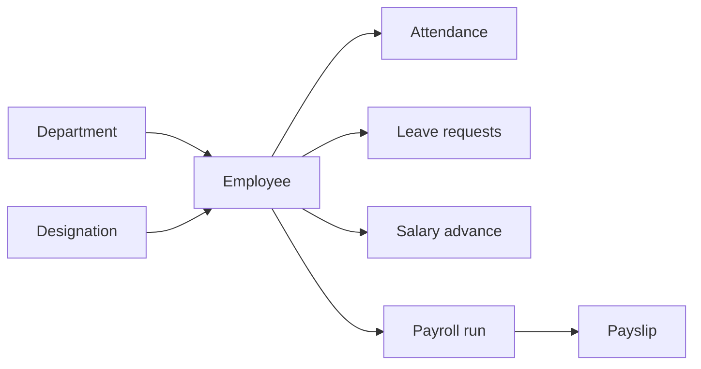

# 03-pages / HR

Routes: `/company/hr/employees`, `/company/hr/attendance`, `/company/hr/leaves`, `/company/hr/payroll`, `/company/hr/advances`, `/company/hr/setup`.

---

## 1. Employees (`/company/hr/employees`)

### 1.1 List

Columns: `Employee`, `Department`, `Contact`, `Joining date`, `Basic salary`, `Status`, `Actions`.

Filters:

| Field | Options |
|---|---|
| `search` | name, code, phone |
| `department_id` | All departments, Accounts & Finance, Admin & HR, Construction, Management, Property Management, Sales & Marketing |
| `employment_type` | All types, Full-time, Part-time, Contract, Intern |
| `status` | All statuses, Active, Probation, On long leave, Resigned, Terminated |

17 rows. Actions: `HR setup`, `Add employee`.

### 1.2 Add/edit employee modal (observed in full)

| Label | Name | Type | Options |
|---|---|---|---|
| Full name * | `name` | text | |
| Employee code | `code` | text | `EMP-####` |
| Phone | `phone` | text | |
| Email | `email` | email | |
| Gender | `gender` | select | Not specified, male, female, other |
| Date of birth | `date_of_birth` | date text | |
| National ID | `national_id` | text | |
| Login account | `user_id` | select | No login + team users with email |
| Address | `address` | textarea | |
| Department | `department_id` | select | departments |
| Designation | `designation_id` | select | designations |
| Branch | `branch_id` | select | branches |
| Reports to | `manager_id` | select | employees |
| Employment type | `employment_type` | select | full_time, part_time, contract, intern |
| Joining date | `joining_date` | date text | |
| Status | `status` | select | active, probation, on_leave, resigned, terminated |
| Exit date | `exit_date` | date text | |
| Basic salary | `basic_salary` | number | |
| Bank & branch | `bank_name` | text | |
| Account number | `bank_account_number` | text | |

Linking an employee to a login account is optional. That link is how team/HR identity is shared (inferred).

---

## 2. Attendance (`/company/hr/attendance`)

Filters: `date` (defaults today), `department_id`. Actions: `Monthly register`, `Load`, `Mark all present`, `Save attendance`.

Table columns: `Employee`, `Attendance`, `Check in`, `Check out`, `Late / overtime`, `Notes`.

- Daily register per department; one row per employee.
- Attendance states likely Present / Absent / Late / Half day / Leave (observed vocabulary not fully captured).
- Check-in/check-out times feed late/overtime calculation.
- `Monthly register` provides a month grid (not captured).
- Saving is idempotent per employee+date (inferred).

---

## 3. Leave (`/company/hr/leaves`)

### 3.1 List

Columns: `Employee`, `Leave type`, `Dates`, `Reason`, `Status`, `Actions`.

Filters: `search`, `leave_type_id` (Annual, Casual, Sick, Unpaid), `status` (Pending, Approved, Rejected, Cancelled). 8 rows.

Actions: `Leave balances`, `Record leave`.

### 3.2 Apply/record leave modal (observed)

| Label | Name | Type | Options |
|---|---|---|---|
| Employee | `employee_id` | select | employees |
| Leave type | `leave_type_id` | select | Annual leave · Paid, Casual leave · Paid, Sick leave · Paid, Unpaid leave · Unpaid |
| From | `start_date` | date text | |
| To | `end_date` | date text | |
| Reason | `reason` | textarea | |
| Approve immediately | `approve_now` | checkbox | |

Decision modal: `Note` textarea; approve/reject actions. Statuses: Pending → Approved/Rejected, with Cancelled available to the requester.

`Leave balances` shows per-employee, per-type entitlement/used/remaining (not captured). Entitlement comes from HR setup (`days_per_year`, paid flag). Overlap/insufficient-balance validation is **inferred**.

---

## 4. Payroll (`/company/hr/payroll`)

Columns: `Period`, `Employees`, `Gross`, `Deductions`, `Net pay`, `Paid`, `Status`.

Filters: `year` (2026…2022), `status` (Draft, Approved, Paid). 3 rows.

Actions: `Payroll rules`, `Run payroll`.

Run payroll modal (observed):

| Label | Name | Type |
|---|---|---|
| Pay period | `period` | select (`2026-12` … earlier months) |
| Notes | `notes` | textarea |

Payroll rules screen was not captured. **ASSUMPTION:** rules define allowances, deductions (tax, provident fund), overtime and absence proration. A run snapshots eligible employees and produces payslips; approve → pay via payouts (employee payee) → status Paid. “Payslip issued” is an observed notification event.

---

## 5. Salary advances (`/company/hr/advances`)

Columns: `Advance`, `Employee`, `Amount`, `Recovery`, `Status`.

Filters: `search`, `status` (Pending approval, Approved, Recovering, Recovered, Rejected). 3 rows.

Primary action: `New advance` (modal, observed in full).

| Label | Name | Type | Notes |
|---|---|---|---|
| Employee | `employee_id` | select | employee · basic salary |
| Amount | `amount` | number | |
| Date | `advance_date` | date text | |
| Monthly recovery | `monthly_deduction` | number | |
| Reason | `reason` | text | |

Lifecycle: `Pending approval → Approved → Recovering → Recovered`, with `Rejected`. Recovery is deducted from payroll each month until the advance is cleared. Advances appear as an approval type and an employee receivable (account `1600 Employee Advances`).

---

## 6. HR setup (`/company/hr/setup`)

Actions: `Designation`, `Department`, `Add leave type`, `Add allowance`, `Save changes`. Leave-type table:

Columns: `Leave type`, `Pay`, `Days per year`, `Requests`, `Status`, `Actions` (4 rows).

Observed modals:

| Modal | Fields |
|---|---|
| Add department | `name`, `code`, `is_active` |
| Add designation | `name`, `department_id`, `is_active` |
| Add leave type | `name`, `code`, `days_per_year`, `is_paid`, `is_active` |

`Add allowance` modal fields were not captured. **ASSUMPTION:** name, code, amount or percentage, taxable flag, active.

---

## 7. Cross-module effects

| Event | Effect |
|---|---|
| Employee created with login | Team member account linked; role/permissions determined by team settings |
| Attendance saved | Payroll input (days worked, OT, late) |
| Leave approved | Attendance/payroll input; balance decreases |
| Payroll approved | Salaries payable/expense posted; payslips generated |
| Payroll paid | Cash/bank decreases; salaries payable decreases |
| Advance approved | Employee receivable increases; cash/bank increases |
| Advance recovery | Payroll deduction; receivable decreases |

---

## 8. Not observed

- Payroll rules screen.
- Payslip detail/print.
- Monthly attendance register.
- Leave balances screen.
- Allowance modal.
- Overtime and tax calculation rules.

---

## 9. Acceptance criteria for a reimplementation

1. Employee directory with department, designation, branch, manager, employment type, status, salary and optional login link.
2. Departments, designations, leave types and allowances setup.
3. Daily attendance with check-in/out, late/OT and bulk mark-present; monthly register.
4. Leave application, approval/rejection with note, entitlement balances and overlap validation.
5. Payroll runs with period, gross/deductions/net and draft→approved→paid lifecycle.
6. Payslips and “payslip issued” notifications.
7. Salary advances with approval, monthly recovery and status tracking.
8. Payroll/advance postings reconcile with accounting.
