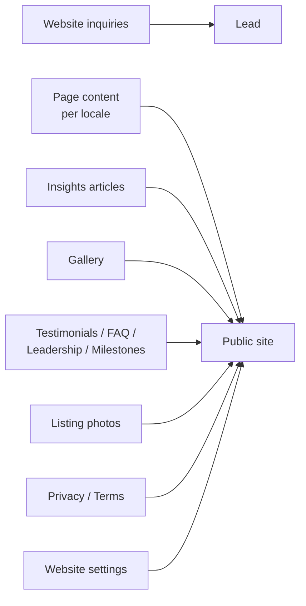

# 03-pages / Website CMS

Routes: `/company/website/inquiries`, `/company/website/content`, `/company/website/posts`, `/company/website/gallery`, `/company/website/items/{type}`, `/company/website/media`, `/company/website/legal`, `/company/website/settings`.

The public website is the same application at `/`. A “View website” action is present on every Website screen.

---

## 1. Website inquiries (`/company/website/inquiries`)

List columns: `Received`, `Name`, `Type`, `Interested in`, `Message`, `Lead`, `Actions`.

Filters:

| Field | Options |
|---|---|
| `type` | All types, General inquiry, Project inquiry, Property inquiry, Site visit request |

Counter: `0 today · 2 this month` (example).

Row content example:

- `13/11/2026 23:07`, Jhonatan Luna, phone `0963313196`, email, `Site visit request`, interested in `Lakeview Heights`, message, `Open lead`, `Visit scheduled`.

Actions: `Open lead` (goes to the created lead), and for non-visit inquiries presumably a convert action. Public form submissions create a **Lead** (and for visit requests also a scheduled **site visit**) — this is the only observed bridge from the public site into the CRM.

**ASSUMPTION:** inquiry records store name, phone, email, type, project/unit interest, message, source page, locale, spam protection and timestamps. Exact table fields were not captured.

---

## 2. Page content (`/company/website/content`)

Structure:

- Locale switch: **Arabic / English / French** → `?locale=ar|en|fr`.
- Page switch: **Home, About, Contact, FAQ, Gallery, Insights, Header and footer** → `/company/website/content/{page}?locale={locale}`.
- Editing: every visible string on the public page is a field; clearing a field restores the original wording. “Each language is edited separately.”

Form action (observed): `POST /company/website/content/home` with multipart encoding.

Field naming convention (observed):

- text: `texts[<key>]`
- image upload: `images[<key>]`

Home page keys observed (partial, in order):

`web_hero_label`, `web_hero_title`, `web_hero_title_accent`, `web_hero_text`, `web_hero_image_alt`, `web_explore_projects`, `web_contact_us`, `web_scroll`, `web_stats_label`, `web_stat_years`, `web_stat_projects`, `web_stat_customers`, `web_stat_cities`, `web_about_image_alt`, `web_about_detail_alt`, `web_years_of_excellence`, `web_about_label`, `web_about_title`, `web_about_title_accent`, `web_about_lead`, `web_about_text`, `web_about_point_design`, `web_about_point_design_text`, `web_about_point_build`, `web_about_point_build_text`, `web_about_point_care`, `web_about_point_care_text`, `web_discover_story`, `web_see_our_work`, `web_projects_label`, `web_projects_title`, `web_projects_title_accent`, `web_filter_projects`, `web_no_projects`, `web_view_all_projects`, `web_why_label`, `web_why_title`, `web_why_title_accent`, `web_why_text`, `web_why_architecture`, `web_why_architecture_text`, `web_why_quality`, … (list continues below the captured fold).

Image slots observed on Home: `home_hero`, `about_main`, `about_detail`.

Image constraints (helper copy): JPG, PNG or WebP, up to **5 MB**.

`Header and footer` is a shared content page (navigation labels, footer text, contact details) edited per locale.

**ASSUMPTION:** each page has a fixed catalogue of keys; unknown keys are ignored; empty string means “fall back to built-in default”.

---

## 3. Insights articles (`/company/website/posts`)

### 3.1 List

Columns: `Title`, `Category`, `Author`, `Publish date`, `Status`, `Actions`.

Filters: `category` (Investment, Architecture, Construction, Buying Guides, Company News), `status` (Published, Scheduled, Draft), search.

Actions: `View website`, `Add article`. Per row: `View on website`, `Edit`, `Delete`.

Article slug appears under the title: `/insights/notes-on-the-commercial-market-this-quarter`, with a read-time label (`1 min read`).

`Publish date` example: `11/10/2026 09:30`.

Statuses: **Draft, Scheduled, Published** (Scheduled implies a future `published_at`).

### 3.2 Add/edit article modal (`#postModal`)

Multipart form, action set per mode (list page shows an empty action).

| Label | Name | Type | Options / notes |
|---|---|---|---|
| Title | `title` | text | |
| Category | `category` | select | investment, architecture, construction, guides, company |
| Summary | `excerpt` | textarea | “One or two sentences shown on cards and in search results. Leave empty to use the start of the article.” |
| Article | `body` | textarea | Markdown supported elsewhere in the CMS; **ASSUMPTION** for articles too |
| Cover image | `cover` | file | |
| Author | `author_id` | select | None + team users |
| Publish date | `published_at` | date/time text | Flatpickr |
| Web address | `slug` | text | placeholder “Auto-generated” |
| Search engine title | `seo_title` | text | |
| Search engine description | `seo_description` | text | |
| Featured article | `is_featured` | checkbox | |

There is **no** `/company/website/posts/create` page (404); create/edit happens in the modal. Delete is demo-blocked.

---

## 4. Gallery (`/company/website/gallery`)

List columns: `Image`, `Category`, `Project`, `Sort order`, `Show on website`, `Actions`.

Filters: `search` (caption), `category` (Projects, Architecture, Interiors, Lifestyle, Construction).

Actions: `View website`, `Add image`.

Add/edit modal (`#galleryModal`):

| Label | Name | Type | Options |
|---|---|---|---|
| Image | `image` | file | |
| Caption | `caption` | text | |
| Category | `category` | select | projects, architecture, interiors, lifestyle, construction |
| Project | `project_id` | select | None + projects |
| Sort order | `sort_order` | number | |
| Show on website | `is_published` | checkbox | |

16 rows in demo.

---

## 5. Website items (`/company/website/items/{testimonial|faq|leader|milestone}`)

Four list screens share one pattern: table + search + an “Add …” action opening a modal.

### 5.1 Testimonials (`/company/website/items/testimonial`)

| Label | Name | Type |
|---|---|---|
| Title | `title` | text |
| Subtitle | `subtitle` | text |
| Body | `body` | textarea |
| Image | `image` | file |
| Rating | `rating` | number/select |
| Locale | `locale` | select |
| Sort order | `sort_order` | number |
| Consent to publish | `consent` | checkbox |
| Published | `is_published` | checkbox |

**ASSUMPTION:** rating is 1–5; consent is a legal acknowledgement that must be true before a testimonial can be published.

### 5.2 FAQ (`/company/website/items/faq`)

| Label | Name | Type |
|---|---|---|
| Title (question) | `title` | text |
| Body (answer) | `body` | textarea |
| Category | `category` | text/select |
| Locale | `locale` | select |
| Sort order | `sort_order` | number |
| Published | `is_published` | checkbox |

### 5.3 Leadership (`/company/website/items/leader`)

| Label | Name | Type |
|---|---|---|
| Title (name) | `title` | text |
| Subtitle (role) | `subtitle` | text |
| Body (bio) | `body` | textarea |
| Image | `image` | file |
| Locale | `locale` | select |
| Sort order | `sort_order` | number |
| Published | `is_published` | checkbox |

### 5.4 Milestones (`/company/website/items/milestone`)

| Label | Name | Type |
|---|---|---|
| Year | `year` | number |
| Title | `title` | text |
| Body | `body` | textarea |
| Locale | `locale` | select |
| Sort order | `sort_order` | number |
| Published | `is_published` | checkbox |

Items are locale-specific; the locale select decides which language version of the public page shows the item.

---

## 6. Listing photos (`/company/website/media`)

Purpose: choose which project/unit photos appear on the public listing pages.

Filters:

- `project` — a project (no “all projects” option observed; one project at a time);
- `unit` — **Project photos** or a specific unit.

Actions: `View website`, `Add photo`.

Modals:

| Modal | Fields |
|---|---|
| `#photoModal` Add photo | `file` (Image), `title` (Description / alt text) |
| `#altModal` Description (alt text) | `title` |

Photos are stored against a project or unit and ordered implicitly (no sort field observed).

**ASSUMPTION:** images are resized/thumbnailed server-side and alt text is required for accessibility.

---

## 7. Legal pages (`/company/website/legal`)

- Locale switch: Arabic / English / French (`?locale=`).
- Two Markdown editors: **Privacy Policy** and **Terms & Conditions**.
- Each has “View on website”.
- Helper copy: “Paste the wording approved by your company. While a page is empty, the website shows sample text marked as a draft and hides it from search engines.”
- Markdown supported: `## Heading`, `**bold**`, `- list item`, `> quote`, `[link text](https://…)`.
- `Save changes`.

**ASSUMPTION:** empty legal pages are `noindex` and display a demo/draft banner; once content is saved the pages become indexable.

---

## 8. Website settings (`/company/website/settings`)

Single multipart form, `POST /company/website/settings`, `Save changes`.

### General

| Label | Name | Type | Notes |
|---|---|---|---|
| Enable website | `site_enabled` | checkbox | “Turn this off to disable your public website. The system will then be used for private operations only.” |
| Tagline | `site_tagline` | text | footer + search results; empty = default |
| Founded in | `site_founded_year` | number | |
| Office hours | `site_office_hours` | text | |

### Social links

`site_facebook`, `site_instagram`, `site_linkedin`, `site_youtube` (all URL).

### Logo and sharing image

| Label | Name | Type | Notes |
|---|---|---|---|
| Logo for light backgrounds | `site_logo_dark` | file | PNG/SVG/JPG/WebP ≤ 2 MB; used in header after scrolling |
| Logo for dark backgrounds | `site_logo_light` | file | used over photos and in footer; falls back to the other logo |
| Default sharing image | `site_seo_image` | file | Open Graph/Twitter default |

The settings page also exposes SEO defaults and contact details below the captured fold; treat the list above as the complete observed set and mark any additional fields **ASSUMPTION**.

---

## 9. Public-site behaviour (observed indirectly)

- Public routes include `/`, `/projects/{slug}`, `/insights/{slug}`, and legal pages.
- Projects are published via project `is_published` + `slug`; featured projects via `is_featured`.
- Disabling the website hides the public site while keeping the panel usable.
- The public site has inquiry and “schedule a visit” forms that create leads/site visits in the panel.
- Locale affects public pages; each CMS item is locale-scoped where noted.
- Google Analytics tag `G-WMCC19VB11` is embedded in the demo; this is demo-specific and must not be copied.

---

## 10. Cross-module effects

| Event | Effect |
|---|---|
| Public inquiry submitted | Lead created with source Website; inquiry row visible in the panel. |
| Public visit request | Lead created + site visit scheduled (status Visit scheduled). |
| Article published (future date) | Status Scheduled until `published_at`, then Published. |
| Website disabled | Public routes return a disabled/placeholder state (not observed); panel unaffected. |
| Project published | Appears on the public projects list and its slug page. |

---

## 11. Not observed

- Public checkout/contact form validation and spam protection.
- Image processing pipeline and CDN URLs.
- Draft preview of articles.
- SEO sitemap/robots management.
- Per-locale fallback rules beyond “clear the field to restore original wording”.
- Article delete (demo-blocked).
- The complete key catalogue for About/Contact/FAQ/Gallery/Insights/Header-footer.

---

## 12. Acceptance criteria for a reimplementation

1. Inquiry inbox with type filter, message detail and one-click conversion to a lead.
2. Per-locale page-content editor with text and image slots, empty-field fallback and save.
3. Insights articles with title, category, summary, body, cover, author, publish date, slug, SEO fields, featured flag and draft/scheduled/published states.
4. Gallery with caption, category, project, sort order and publish toggle.
5. Testimonials, FAQ, leadership and milestones with locale, sort order and publish toggle (plus rating/consent for testimonials).
6. Project/unit listing-photo manager with alt text.
7. Markdown legal pages with a noindex draft state while empty.
8. Website settings for enable/disable, tagline, founded year, hours, social links, logos and sharing image.
9. Public site consumes the same content and creates leads/visits through the documented bridge.
