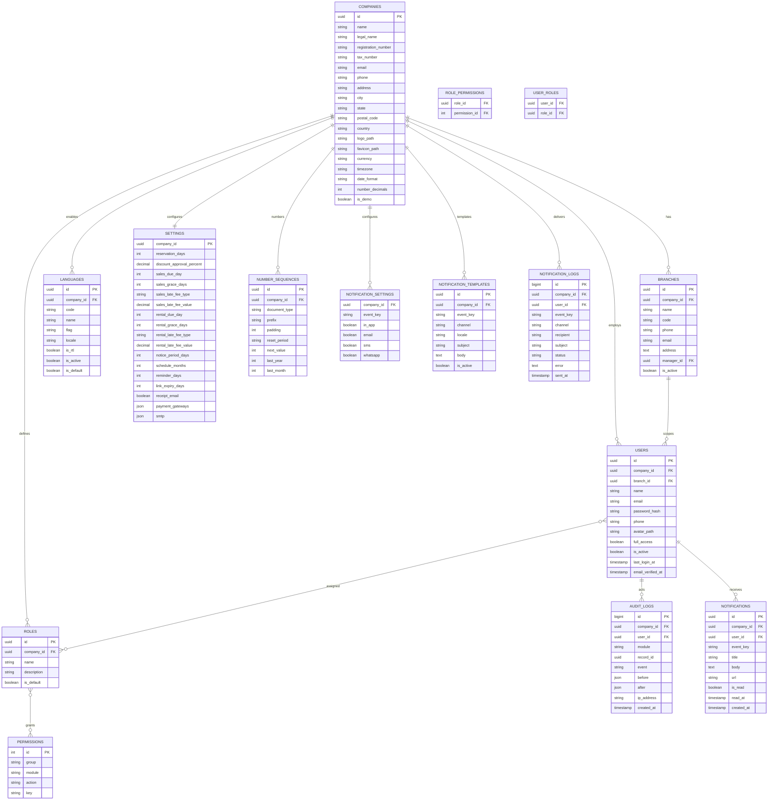
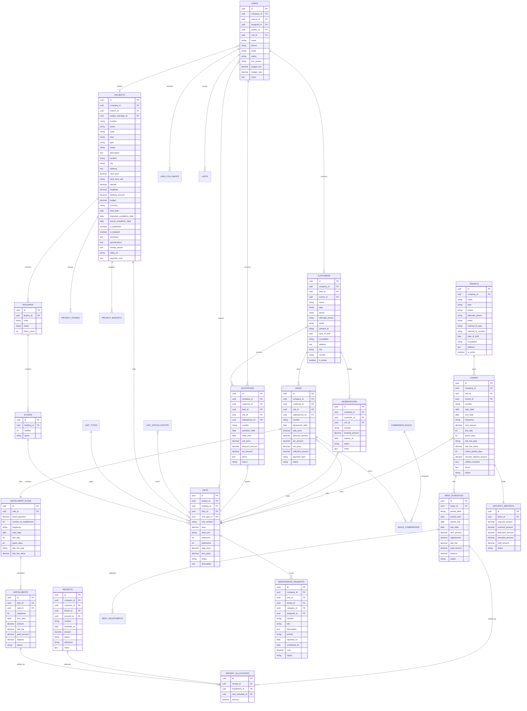
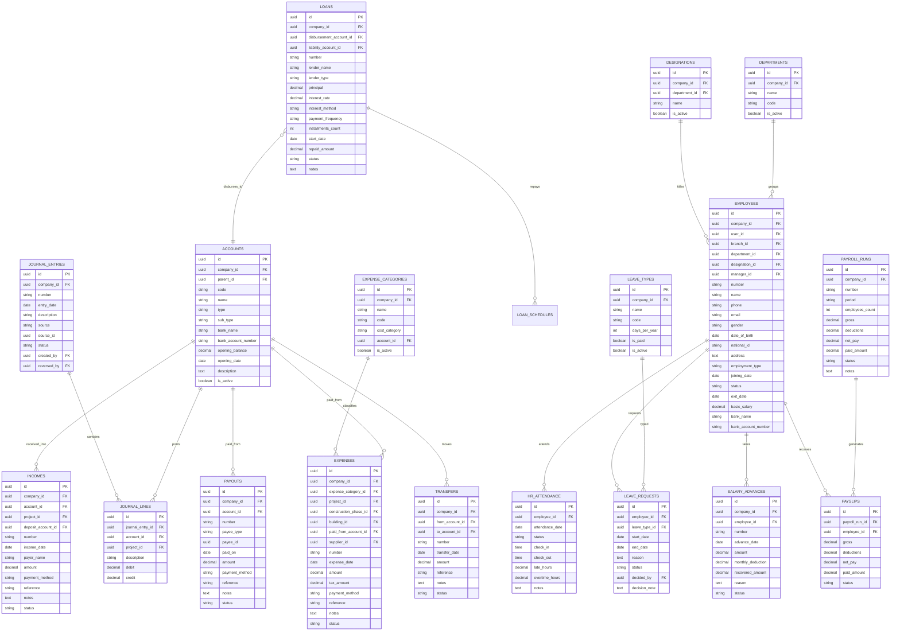
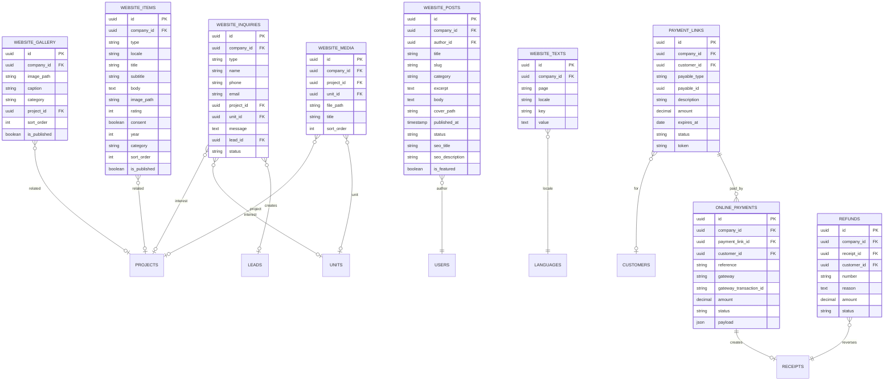

# 05 — Inferred data model

The demo exposes no schema. This model is reconstructed from URLs, table columns, form field names, select options and cross-module behaviour. It is sufficient to design the EstateVista schema; it is **not** a claim about the demo's actual tables.

Labels: **Observed** = field/relationship seen; **Inferred** = required by observed behaviour; **ASSUMPTION** = design choice.

---

## 1. Modelling conventions

- Multi-tenant: every business row carries `company_id`; all queries are scoped to the signed-in user's company.
- Primary keys: UUIDs for business records (demo uses UUIDv7); small integer IDs are acceptable internally.
- Human references: separate immutable `number` columns generated from `number_sequences` (prefix, padding, reset period).
- Money: `numeric(18,2)`; store currency per company (and per project where a project currency is set).
- Soft delete: `deleted_at` on entities referenced by history; never hard-delete financial records.
- Audit: `created_by`, `updated_by`, timestamps; append-only `audit_logs` with before/after snapshots.
- Enums: stored as strings with application-level validation (portable across Postgres/MySQL).
- Files: `documents` table with owner polymorphic link, path, MIME, size, category.

---

## 2. Platform, identity and configuration



Notes:

- `USERS.full_access` corresponds to the “Full access” radio; otherwise permissions are the union of `USER_ROLES → ROLE_PERMISSIONS`.
- The demo shows 144 permissions; the matrix is module × action.
- Company settings are split into typed columns plus JSON for gateway/SMTP secrets (encrypted at rest).
- Notification preferences per user are a separate table (`user × event × channel`) layered under the company matrix; copy states users can turn channels off but not on.

---

## 3. Properties, sales and rental



Business rules encoded in this model:

- A unit has exactly one **current** state but a history of states (`unit_status_history`).
- A sale has one installment plan; full-payment sales can be modelled as a plan with one installment or no plan.
- `receipt_allocations` is polymorphic between sale installments and rent schedules so one receipt engine can serve both.
- Quotations optionally reference a lead **or** a customer; converting a lead yields a customer.
- Deposits are one-to-one with a lease; deductions/refunds are transactions against it (detail table omitted for brevity — add `deposit_transactions` with type/amount/reason).
- Unit status transitions: Available → Reserved (reservation) → Sold (sale) / Rented (lease); cancellation reverses.

---

## 4. Construction, purchasing and inventory

```mermaid
erDiagram
  MATERIAL_CATEGORIES ||--o{ MATERIALS : groups
  MATERIALS ||--o{ STOCK_BALANCES : stocked
  WAREHOUSES ||--o{ STOCK_BALANCES : holds
  STOCK_BALANCES ||--o{ STOCK_MOVEMENTS : moves
  MATERIAL_ISSUES ||--o{ MATERIAL_ISSUE_ITEMS : lines
  MATERIAL_ISSUE_ITEMS }o--|| MATERIALS : issues
  MATERIAL_ISSUES }o--|| WAREHOUSES : from
  MATERIAL_ISSUES }o--|| PROJECTS : to

  SUPPLIERS ||--o{ PURCHASE_ORDERS : supplies
  PURCHASE_ORDERS ||--o{ PURCHASE_ORDER_ITEMS : lines
  PURCHASE_ORDER_ITEMS }o--|| MATERIALS : orders
  SUPPLIERS ||--o{ PURCHASES : bills
  PURCHASES ||--o{ PURCHASE_ITEMS : lines
  PURCHASE_ITEMS }o--|| MATERIALS : receives
  PURCHASES }o--|| WAREHOUSES : into

  CONTRACTORS ||--o{ CONTRACTOR_CONTRACTS : signs
  CONTRACTOR_CONTRACTS ||--o{ CONTRACTOR_BILLS : bills
  CONTRACTOR_BILLS ||--o{ PAYOUT_ALLOCATIONS : paid_by

  LABORERS ||--o{ LABOR_ATTENDANCE : attends
  LABOR_ATTENDANCE }o--|| PROJECTS : on

  MATERIALS {
    uuid id PK
    uuid company_id FK
    uuid material_category_id FK
    string sku
    string name
    string unit
    decimal reorder_level
    decimal average_cost
    decimal standard_cost
    boolean is_active
  }
  WAREHOUSES {
    uuid id PK
    uuid company_id FK
    uuid project_id FK
    string name
    string code
    string type
    text address
    boolean is_active
  }
  STOCK_BALANCES {
    uuid id PK
    uuid warehouse_id FK
    uuid material_id FK
    decimal quantity
    decimal average_cost
  }
  STOCK_MOVEMENTS {
    uuid id PK
    uuid warehouse_id FK
    uuid material_id FK
    string type
    decimal quantity
    decimal unit_cost
    string reference_type
    uuid reference_id
    date moved_on
    uuid created_by FK
  }
  MATERIAL_ISSUES {
    uuid id PK
    uuid company_id FK
    uuid project_id FK
    uuid construction_phase_id FK
    uuid building_id FK
    uuid floor_id FK
    uuid warehouse_id FK
    string number
    date issue_date
    text notes
    decimal total_cost
    string status
  }
  PURCHASE_ORDERS {
    uuid id PK
    uuid company_id FK
    uuid supplier_id FK
    uuid project_id FK
    uuid warehouse_id FK
    string number
    date order_date
    date expected_date
    decimal discount_amount
    decimal tax_amount
    decimal total
    text notes
    string status
  }
  PURCHASES {
    uuid id PK
    uuid company_id FK
    uuid supplier_id FK
    uuid project_id FK
    uuid warehouse_id FK
    string number
    string supplier_invoice_number
    date purchase_date
    date due_date
    decimal discount_amount
    decimal tax_amount
    decimal total
    decimal paid_amount
    string status
    string payment_status
  }
  SUPPLIERS {
    uuid id PK
    uuid company_id FK
    string name
    string code
    string type
    string contact_person
    string phone
    string email
    text address
    string tax_number
    text notes
    boolean is_active
  }
  CONTRACTORS {
    uuid id PK
    uuid company_id FK
    uuid trade_id FK
    string name
    string code
    string contact_person
    string phone
    string email
    text address
    string tax_number
    boolean is_active
  }
  CONTRACTOR_CONTRACTS {
    uuid id PK
    uuid company_id FK
    uuid contractor_id FK
    uuid project_id FK
    string number
    string title
    date start_date
    date end_date
    decimal contract_value
    decimal retention_percent
    string status
  }
  LABORERS {
    uuid id PK
    uuid company_id FK
    uuid labor_category_id FK
    uuid project_id FK
    string number
    string name
    string phone
    string worker_type
    decimal rate
    boolean is_active
  }
  LABOR_ATTENDANCE {
    uuid id PK
    uuid laborer_id FK
    uuid project_id FK
    date attendance_date
    string status
    decimal hours
    decimal ot_hours
    uuid construction_phase_id FK
    decimal amount
  }
```

Inventory rule: stock is the sum of movements per warehouse × material; purchases and issues write movements, and `stock_balances` is a materialised cache that must reconcile with the ledger.

---

## 5. Finance, accounting and HR



Accounting rules:

- Every financial module writes a balanced `journal_entries` + `journal_lines` pair.
- `journal_entries.source`/`source_id` link back to the originating sale, installment, expense, payout, transfer or loan.
- Reversal creates a new entry and links `reversed_by`; originals are immutable.
- Trial balance, P&L, balance sheet, cash flow and aging reports are queries over journal lines + open documents, not stored totals.
- Payroll and advances post to `2600 Salaries Payable` and `1600 Employee Advances` respectively.

---

## 6. Website and payments



Website content is key/value per page and locale; clearing a value deletes the override and the UI falls back to the built-in default.

---

## 7. Cross-cutting tables

| Table | Purpose |
|---|---|
| `documents` | polymorphic uploads (`owner_type`, `owner_id`), category, path, MIME, size, uploaded_by |
| `unit_status_history` | unit, from_status, to_status, reason, changed_by, changed_at |
| `approvals` | type (sale_discount, purchase_order, expense, salary_advance), requester, reference, amount/reason, status, decided_by, note, timestamps |
| `tasks` | title, description, project, assignee, priority, status, due_date, progress, created_by |
| `task_comments` / `task_watchers` | collaboration |
| `recurring_tasks` | template + frequency/interval/day + next_run_at |
| `visits` | lead/customer, project/unit, scheduled_at, salesperson, status, notes |
| `lead_followups` | lead, type, scheduled_at, completed_at, outcome, notes |
| `sales_commissions` | salesperson, sale, base amount, rate, commission, status |
| `commission_rules` | applicability, rate/amount, payable trigger, active |
| `contracts` | contractor contract (also covered above) |
| `contractor_bills` | contract, number, period, amount, retention, status |
| `payout_allocations` | payout → payable document (purchase, bill, commission, advance, deposit) |

---

## 8. Enum catalogue (observed)

| Domain | Values |
|---|---|
| Project type | `residential`, `commercial`, `mixed_use`, `land`, `other` |
| Project status | `planning`, `active`, `on_hold`, `completed`, `archived` |
| Unit status | `draft`, `available`, `reserved`, `sold`, `rented`, `blocked`, `under_maintenance` |
| Lead stage | `new`, `contacted`, `qualified`, `visit_scheduled`, `negotiation`, `won`, `lost` |
| Visit status | `scheduled`, `completed`, `cancelled`, `no_show` |
| Customer/tenant type | `individual`, `company` |
| Quotation status | `draft`, `sent`, `accepted`, `rejected`, `expired`, `converted` |
| Reservation status | `active`, `converted`, `cancelled`, `expired` |
| Sale status | `pending_approval`, `active`, `fully_paid`, `cancelled` |
| Schedule status | `upcoming`, `due`, `partly_paid`, `paid`, `overdue`, `waived`, `cancelled` |
| Receipt status | `completed`, `refunded`, `voided` |
| Lease status | `draft`, `active`, `expired`, `terminated`, `renewed` |
| Deposit status | `awaiting_settlement`, `to_collect`, `held`, `settled` |
| Maintenance status | `open`, `assigned`, `in_progress`, `completed`, `closed`, `cancelled` |
| Priority | `low`, `medium`, `high`, `urgent` |
| Material issue status | `pending_approval`, `approved`, `issued`, `rejected`, `cancelled` |
| PO status | `draft`, `approved`, `partly_received`, `received`, `cancelled` |
| Purchase status | `draft`, `received`, `cancelled` + payment `unpaid`, `partly_paid`, `paid` |
| Contract status | `draft`, `active`, `completed`, `terminated` |
| Expense status | `draft`, `approved`, `cancelled` |
| Income/payout/transfer status | `posted`, `voided` |
| Loan status | `active`, `closed` |
| Journal status | `posted`, `reversed` |
| Task status | `todo`, `in_progress`, `in_review`, `done`, `cancelled` |
| Leave status | `pending`, `approved`, `rejected`, `cancelled` |
| Advance status | `pending_approval`, `approved`, `recovering`, `recovered`, `rejected` |
| Payroll status | `draft`, `approved`, `paid` |
| Notification delivery | `queued`, `sent`, `failed`, `skipped` |
| Payment link status | `active`, `paid`, `expired`, `cancelled` |
| Online payment status | `pending`, `completed`, `failed`, `refunded`, `voided` |
| Refund status | `processing`, `completed`, `failed` |
| Article status | `draft`, `scheduled`, `published` |
| Gateway | `sslcommerz`, `stripe` |

---

## 9. Integrity rules to enforce

1. Every child row's `company_id` must equal its parent's; enforce with composite FKs or service-layer checks.
2. Reference numbers are unique per company per document type.
3. A unit cannot have two active reservations, sales or leases simultaneously.
4. A sale's unit must be `available` or `reserved` at creation; it becomes `sold` on activation.
5. Installment amounts must sum to `net_price − down_payment` (within rounding tolerance).
6. Rent schedule amounts must sum to the lease value over the term.
7. Receipt allocations must not exceed the receipt amount or the open balance of the target document.
8. Journal debits = credits per entry; lines cannot have both debit and credit.
9. Stock cannot go negative without an explicit override + audit entry.
10. Payroll/advances cannot be paid twice; idempotency by run/payslip.
11. Financial rows are never hard-deleted; use void/reversal.
12. Every mutation writes an audit row.
13. Deleting a parent with children is blocked; deactivate instead.
14. Locale-scoped CMS rows are unique per `(company, type, locale, sort_order)` where applicable.

---

## 10. Data not observable

- Actual table/column names and types.
- Indexes, constraints, triggers and cascade rules.
- Whether the demo uses soft deletes, and which tables.
- Multi-currency storage per transaction (only a company/project currency was observed).
- Whether balances are materialised or computed.
- Sequence-locking strategy under concurrency.
- Retention policy for audit and notification logs.

These are design decisions for the reimplementation, not demo facts.
